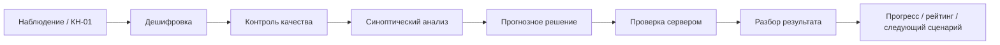
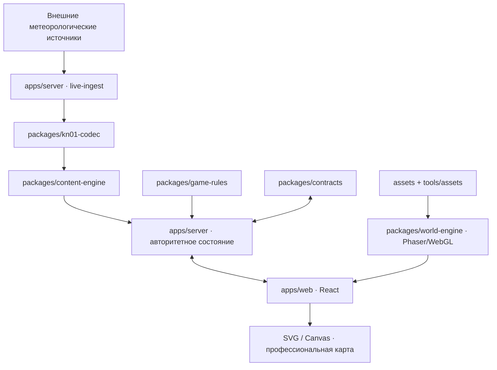
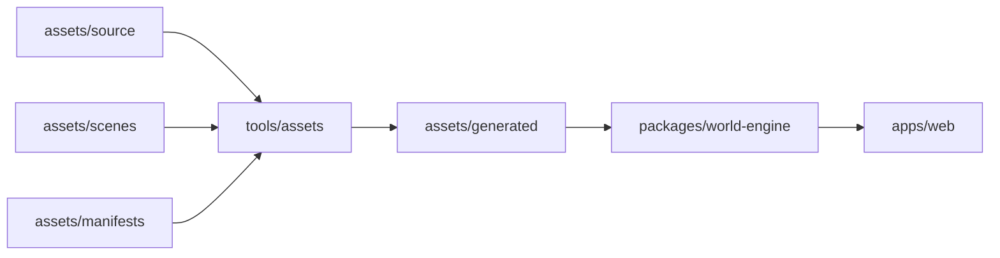
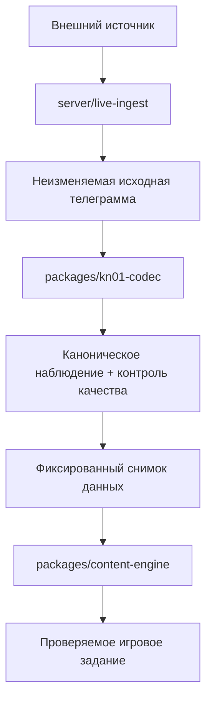

<div align="center">

# 🌦️ 26063: Позывной «Синоптик»

### Браузерная соревновательная игра-тренажёр по синоптической метеорологии

**Российская синоптическая школа · КН-01 · профессиональный анализ · сетевые состязания · живой пиксельный мир**

[](https://github.com/f2re/synopsis_game/actions/workflows/ci.yml)
[](https://github.com/f2re/synopsis_game/actions/workflows/docs-quality.yml)
[](https://github.com/f2re/synopsis_game/actions/workflows/release.yml)
[](package.json)
[](package.json)
[](package.json)
[](apps/web/package.json)
[](apps/web/package.json)
[](packages/world-engine/package.json)
[](https://github.com/f2re/synopsis_game/stargazers)
[](https://github.com/f2re/synopsis_game/issues)


**Состояние:** первый рабочий срез · активная разработка

[Документация](docs/README.md) · [Концепция](docs/00_VISION_GDD.md) · [Архитектура](docs/architecture/README.md) · [Синоптическая школа](docs/01_RUSSIAN_SYNOPIC_SCHOOL.md) · [Художественное направление](docs/07_ART_DIRECTION_AND_UX.md) · [План реализации](docs/08_IMPLEMENTATION_ROADMAP.md) · [Как участвовать](CONTRIBUTING.md)

</div>

---

> **Знание не проверяется перед игровым действием — знание и есть игровое действие.**

## О проекте

**«26063: Позывной „Синоптик“»** — браузерная учебная игра, в которой работа синоптика превращена в игровой процесс: от дешифровки наблюдения и контроля исходных данных до фронтологического анализа и принятия прогнозного решения.

`26063` — международный номер метеорологической станции Санкт-Петербурга, превращённый в локальный код игрового мира. Он используется в архивных сериях, служебных бланках, маркировке оборудования и системе допуска. Позывной **«Синоптик»** обозначает профессиональную роль игрока, который по мере обучения получает всё больше самостоятельности.

Проект строится не как викторина «вопрос → четыре ответа», а как последовательность профессиональных действий:

```text
наблюдение → дешифровка → контроль качества → анализ → прогнозное решение → проверка → разбор
```

Игрок работает с КН-01, схемой нанесения станции, приземными картами, абсолютной и относительной топографией, фронтами, высотными фронтальными зонами и другими элементами синоптического анализа. Результат этих действий определяет исход смены, блица, дуэли или командного состязания.

## Почему проект устроен именно так

| Принцип | Что это означает на практике |
|---|---|
| **Методическая достоверность** | Эталон ответа формируется по проверяемому источнику и версионированному методическому профилю российской синоптической школы. |
| **Сервер — источник истины** | Задания, ответы, состояние матча, рейтинг и награды определяются сервером; клиент не получает правильный ответ заранее. |
| **Воспроизводимость** | Матч можно восстановить по версиям правил, содержания, исходных данных и зерну случайности. |
| **Профессиональная карта ≠ декоративный мир** | Синоптическая графика живёт в точной системе SVG/Canvas, а кампус и атмосфера — в Phaser/WebGL. |
| **Исходники графики важнее результата сборки** | Спрайты, сцены и манифесты являются источником истины; сгенерированные атласы вручную не исправляются. |
| **Независимая приёмка** | Исполнитель не принимает собственную работу: методика, графика, производительность и интеграция имеют отдельные роли проверки. |

Основные инварианты собраны в [основополагающих принципах проекта](docs/00A_FOUNDATIONAL_RUNTIME_PRINCIPLES.md).

## Текущее состояние

| Область | Состояние |
|---|---|
| Архитектура браузерного клиента и сервера | 🟢 сформирована |
| Phaser/WebGL-контур живого мира | 🟢 подключён |
| Первый вертикальный срез `Hub → Archive` | 🟢 реализован |
| Конвейер пиксельных ресурсов | 🟢 сформирован и валидируется |
| Методические профили и пакет учебного содержания | 🟢 версионируются |
| CI: валидаторы, типизация, тесты, сборка | 🟢 действует |
| Linux x86-64 релизный архив | 🟢 собирается автоматически |
| Проверка релизного пакета под Astra Linux 1.7 | 🟢 включена в CI |
| Каноническое художественное наполнение сцен | 🟡 развивается |
| Полный контур актуальных КН-01 | 🟡 развивается |
| Сетевые режимы и автономный экран арены | 🟡 поэтапная реализация |

Проект находится в активной разработке и пока не считается завершённым учебным продуктом.

## Визуальное направление

Живой кампус — это многослойная сцена, меняющаяся по времени суток, сезону и состоянию мира:

```text
рассвет → день → золотой час → сумерки → ночь
```

Ниже — **композиционные референсы**, а не снимки текущей сборки. Они сохраняются как ориентиры по иерархии, плотности, атмосфере и языку интерфейса; устаревшие надписи и география не являются каноническими.

| Кампус | Блиц | Синоптическая дуэль |
|---|---|---|
|  |  |  |

Канонические правила оформления: [базовый художественный язык](docs/design/PIXEL_ART_BASELINE_COZY_SCIENCE.md), [руководство по пиксельной графике](docs/design/PIXEL_ART_STYLE_GUIDE.md) и [конвейер ресурсов](docs/design/PIXEL_ASSET_PIPELINE.md).

## Игровой цикл



Типовые действия игрока:

- дешифровать группы КН-01;
- собрать или прочитать станционную модель;
- обнаружить ошибку или противоречие в наблюдении;
- проанализировать приземное поле и барические образования;
- сопоставить АТ/ОТ и вертикальную структуру атмосферы;
- провести фронтологический анализ;
- выбрать и обосновать прогнозное решение;
- сравнить собственный ход анализа с эталонным разбором.

## Архитектура



Канонический первый рабочий срез — **два приложения и набор специализированных пакетов**, без преждевременного дробления на микросервисы.

```text
apps/
├── web/                  # React, интерфейс, карта, Phaser-сцены, /arena-tv
└── server/               # авторитетный модульный монолит

packages/
├── kn01-codec/           # разбор, кодирование и контроль КН-01
├── content-engine/       # формирование заданий и проверка ответов
├── game-rules/           # детерминированные игровые правила
├── world-engine/         # Phaser 4 / WebGL
└── contracts/            # версионированные структуры обмена

content/                  # учебное содержание, источники и методические профили
assets/                   # исходники, сцены, манифесты и результаты сборки
design/                   # визуальные референсы и токены оформления
tools/                    # валидаторы и сборочные инструменты
deploy/                   # установка и эксплуатация
scripts/release/          # формирование релизного архива
docs/                     # каноническая документация проекта
agents/                   # роли, зоны ответственности и правила приёмки
```

Подробнее: [архитектура](docs/architecture/README.md), [технические требования](docs/06_TECHNICAL_REQUIREMENTS.md), [ADR-0004](docs/decisions/ADR-0004-phaser-webgl-pixel-asset-pipeline.md), [ADR-0005](docs/decisions/ADR-0005-mvp-modular-monolith-boundaries.md).

## Технологии

| Слой | Технологии и назначение |
|---|---|
| Браузерный интерфейс | **React 19**, **TypeScript 5.9**, **Vite 8** |
| Живой игровой мир | **Phaser 4.2**, **WebGL** |
| Профессиональная метеографика | **SVG / Canvas** |
| Сервер | **Node.js**, TypeScript, модульный монолит |
| Рабочая область | **pnpm 10**, монорепозиторий `apps/*`, `packages/*`, `tools/*` |
| Контроль качества | Python-валидаторы, типизация, серверные тесты, GitHub Actions |
| Выпуск | Linux x86-64 архив, встроенный Node.js LTS, systemd, Nginx/Apache |
| Целевая проверка | Astra Linux Special Edition 1.7 |

## Быстрый запуск

### Требования

- Node.js **20.19+**;
- pnpm **10.34.8**;
- Python 3 — для репозиторных валидаторов;
- Git.

### Установка

```bash
git clone https://github.com/f2re/synopsis_game.git
cd synopsis_game
corepack enable
pnpm bootstrap
```

### Разработка

Браузерный клиент:

```bash
pnpm dev:web
```

Сервер:

```bash
pnpm dev:server
```

Адрес браузерного клиента выводится Vite при запуске. Сервер собирается из TypeScript и запускается из `apps/server/dist`.

### Сборка

```bash
pnpm typecheck
pnpm test:server
pnpm build
```

## Проверки качества

Перед объединением значимого изменения должны проходить репозиторные проверки:

```bash
python tools/validate_repo.py
python tools/validate_architecture.py
python tools/validate_brand.py
python tools/validate_pixel_art.py
python tools/validate_deployment.py
python tools/test_deployment.py
pnpm typecheck
pnpm test:server
pnpm build
```

CI дополнительно проверяет shell/Python-скрипты, запускает production-сервер, проверяет `/ready` и `/health`, собирает Linux-релиз и прогоняет проверку кандидата для Astra Linux 1.7.

## Конвейер графики

Производственная графика строится воспроизводимо:



Правило простое: **не исправлять вручную то, что является результатом сборки**. Изменяется исходный ресурс, сцена или манифест — затем результат генерируется повторно.

Документы: [конвейер пиксельной графики](docs/design/PIXEL_ASSET_PIPELINE.md), [система живого мира](docs/design/LIVING_WORLD_SYSTEM.md), [Phaser/WebGL и ресурсы](docs/architecture/GAME_RUNTIME_AND_ASSETS.md).

## Актуальные КН-01 и воспроизводимость



После старта матч не должен зависеть от изменяющегося внешнего потока. Он работает с конкретным снимком данных и конкретными версиями правил и методики.

Подробнее: [поток актуальных КН-01](docs/content/LIVE_KN01_PIPELINE.md) и [политика источников](docs/09_SOURCE_POLICY.md).

## Геометрия синоптических заданий

Эталон ответа не хранится в экранных пикселях. Каноническое пространство бланка — `[0..1000] × [0..1000]`; координаты экрана преобразуются до отправки результата.

Для последовательностей и вариантов сервер выполняет детерминированную перестановку по зерну раунда. Обратное соответствие остаётся на сервере. Это уменьшает возможность угадывания по позиции и делает повтор матча воспроизводимым.

Подробнее: [модель содержания](docs/05_CONTENT_SCHEMA.md).

## Автономный экран арены

`Arena TV` — маршрут `/arena-tv` в `apps/web` с ролью `display` только для чтения. На первом рабочем срезе отдельные приложения для экрана и зрителя не создаются.

Экран может автоматически выбирать активный матч, итог, яркий момент, таблицу лидеров или демонстрационную сцену кампуса. Приватные данные и правильный ответ не раскрываются раньше разрешённого правилами момента.

Подробнее: [автономный экран арены](docs/realtime/AUTONOMOUS_ARENA_DISPLAY.md).

## Разработка с агентами

Проект рассчитан на параллельную работу специализированных ИИ-агентов, но их полномочия разделены так же, как роли в обычной инженерной команде.

| Направление | Ответственные роли |
|---|---|
| Методика | `meteo-methodologist-ru`, `meteo-verifier` |
| Художественное направление | `art-director` |
| Пиксельные ресурсы | `pixel-asset-designer`, `pixel-art-quality-reviewer` |
| Сборка ресурсов | `pixel-asset-pipeline-engineer` |
| Phaser/WebGL | `game-runtime-webgl-engineer` |
| Живой мир | `living-world-engineer` |
| Производительность | `web-performance-engineer` |
| Интеграция и выпуск | `integration-release-engineer` |

Исполнитель и принимающий агент не должны совпадать для критических областей.

Главные файлы: [`AGENTS.md`](AGENTS.md), [`agents/registry.yaml`](agents/registry.yaml), [`agents/tasks/FOUNDATION_OWNERSHIP.md`](agents/tasks/FOUNDATION_OWNERSHIP.md), [`agents/QUALITY_GATES.md`](agents/QUALITY_GATES.md).

## Документация

| Раздел | Документ |
|---|---|
| Общий указатель | [docs/README.md](docs/README.md) |
| Концепция и игровой замысел | [docs/00_VISION_GDD.md](docs/00_VISION_GDD.md) |
| Основополагающие принципы | [docs/00A_FOUNDATIONAL_RUNTIME_PRINCIPLES.md](docs/00A_FOUNDATIONAL_RUNTIME_PRINCIPLES.md) |
| Российская синоптическая школа | [docs/01_RUSSIAN_SYNOPIC_SCHOOL.md](docs/01_RUSSIAN_SYNOPIC_SCHOOL.md) |
| Игровой процесс и баланс | [docs/02_GAMEPLAY_AND_BALANCE.md](docs/02_GAMEPLAY_AND_BALANCE.md) |
| Сетевые режимы и трансляция | [docs/03_REALTIME_PVP_AND_BROADCAST.md](docs/03_REALTIME_PVP_AND_BROADCAST.md) |
| Учебное содержание | [docs/04_CONTENT_AND_TASKS.md](docs/04_CONTENT_AND_TASKS.md) |
| Модель данных | [docs/05_CONTENT_SCHEMA.md](docs/05_CONTENT_SCHEMA.md) |
| Технические требования | [docs/06_TECHNICAL_REQUIREMENTS.md](docs/06_TECHNICAL_REQUIREMENTS.md) |
| Художественное направление и UX | [docs/07_ART_DIRECTION_AND_UX.md](docs/07_ART_DIRECTION_AND_UX.md) |
| План реализации | [docs/08_IMPLEMENTATION_ROADMAP.md](docs/08_IMPLEMENTATION_ROADMAP.md) |
| Политика источников | [docs/09_SOURCE_POLICY.md](docs/09_SOURCE_POLICY.md) |
| Бренд и лор `26063` | [docs/BRAND_AND_LORE_26063.md](docs/BRAND_AND_LORE_26063.md) |
| Архитектурные решения | [docs/decisions/](docs/decisions/) |
| Развёртывание и обновления | [docs/deployment/DEPLOYMENT_AND_UPDATES.md](docs/deployment/DEPLOYMENT_AND_UPDATES.md) |

## Выпуски и развёртывание

Релиз проекта — готовый архив Linux x86-64, а не набор исходников для сборки на целевой машине. В него входят браузерный клиент, сервер, встроенный Node.js LTS и эксплуатационные шаблоны.

```text
/opt/synopsis-game/releases/<version>   # версии приложения
/etc/synopsis-game                      # локальная конфигурация и секреты
/var/lib/synopsis-game                  # изменяемые данные
```

Обновление проектируется атомарным: резервная копия → установка новой версии → переключение → проверка `/ready` → автоматический возврат при неуспехе.

GitHub Actions автоматически формирует архив `synopsis-game-<version>-linux-x64.tar.gz`, SHA-256 и GitHub Release для версии из `package.json`.

Подробнее: [развёртывание и обновления](docs/deployment/DEPLOYMENT_AND_UPDATES.md) и [ADR-0006](docs/decisions/ADR-0006-release-deployment-and-update-model.md).

## Как участвовать

1. Прочитайте [CONTRIBUTING.md](CONTRIBUTING.md) и нужный канонический документ из `docs/`.
2. Не вводите новую архитектурную сущность, формат данных или художественное правило без проверки существующих решений.
3. Для метеорологического содержания указывайте источник и методический профиль.
4. Для графики меняйте исходники и манифесты, а не результаты генерации.
5. Перед отправкой изменения прогоните соответствующие валидаторы, типизацию, тесты и сборку.
6. Значимые изменения фиксируйте в [CHANGELOG.md](CHANGELOG.md).

Сообщения об уязвимостях оформляются по [SECURITY.md](SECURITY.md).

## Лицензия

Лицензия проекта пока **не выбрана**. Публичность репозитория сама по себе не означает предоставление разрешения на свободное распространение или создание производных работ. До появления файла `LICENSE` ориентируйтесь на условия GitHub и действующее авторское право.

---

<div align="center">

### 26063: Позывной «Синоптик»

**Наблюдай · анализируй · обосновывай · отвечай за прогноз**

[Наверх ↑](#-26063-позывной-синоптик)

</div>
