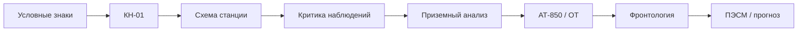

<div align="center">

# 🌦️ Синоптический центр

### Современная соревновательная учебная игра по синоптической метеорологии

**Российская синоптическая школа · процедурное обучение · realtime PvP · командные смены · реальные архивные ситуации**

[](https://github.com/f2re/synopsis_game/actions/workflows/docs-quality.yml)


[Документация](docs/README.md) · [GDD](docs/00_VISION_GDD.md) · [Российская школа](docs/01_RUSSIAN_SYNOPIC_SCHOOL.md) · [MVP backlog](docs/roadmap/MVP_BACKLOG.md) · [Идеи](docs/ideas/IDEA_BACKLOG.md) · [Contributing](CONTRIBUTING.md)

</div>

---

## Идея

**«Синоптический центр»** — web-first игра для студентов-метеорологов, где профессиональная операция синоптика является непосредственно игровым действием.

> **Знание не проверяется перед игровым действием — знание и есть игровое действие.**

Игрок не отвечает на тест ради условной монеты. Он дешифрирует КН-01, собирает схему станции, проводит критику наблюдений, анализирует приземную карту, АТ/ОТ и фронты — и именно качество этих действий определяет исход смены, дуэли или командного матча.

Проект ориентирован на отечественную синоптическую школу и разделяет:

1. классическую учебную методику;
2. практикумы и кафедральные варианты;
3. действующие нормативные/методические документы;
4. игровые условности, которые никогда не выдаются за метеорологические правила.

---

## Что делает проект отличающимся

| Принцип | Реализация |
|---|---|
| 🎯 Процедурное обучение | студент запоминает **что и в каком порядке делать**, а не только определения |
| 🗺️ Карта — главный экран | активная карта/задача доминирует, дашборды вторичны |
| 🇷🇺 Российская школа | В/Н, П/Р, подъём карты, историчность, трёхмерность, АТ/ОТ, ВФЗ, ПЭСМ |
| ⚔️ Knowledge-as-action | правильная профессиональная операция сама создаёт игровой эффект |
| 🧠 Mastery ≠ рейтинг | учебный прогресс и PvP Arena Rating разделены |
| 🛰️ Реальные ситуации | сложные кейсы строятся на архивных данных с provenance |
| 🧩 Контент без переписывания движка | задания, профили методик и сценарии — versioned data |
| 🧑‍🏫 Classroom-first | QR-room, массовый блиц, projector spectator, instructor analytics |
| 🔁 Replay | матч хранится как event log с версиями rules/content/profile |
| ⚖️ Честный Ranked | постоянная прокачка не усиливает игрока в рейтинговом матче |

---

## Основные игровые режимы

### Solo

- ежедневная «Синоптическая смена»;
- интервальное повторение;
- квалификационные допуски;
- архивные ситуации;
- комплексные «боссы» — реальные синоптические процессы.

### Realtime PvP

- **Blitz** — 60–120 секунд коротких заданий;
- **1v1 Синоптическая дуэль** — 3–6 минут;
- **2v2 Синоптическая бригада** — приземный + высотный анализ;
- **3v3 Оперативная смена** — наблюдения, фронтология, аэрология;
- массовая квалификация + playoff;
- турнир учебной группы.

### Cooperative PvE

Примеры крупных сценариев:

- ныряющий циклон;
- южный циклон;
- блокирующий антициклон;
- зимнее ОЯ;
- активный конвективный фронт;
- авиационная смена.

---

## Как учебная операция становится игровой механикой

| Учебная операция | Игровая роль |
|---|---|
| КН-01 / короткий decode | быстрый импульс + оперативный ресурс |
| Схема станции | защитный щит |
| Критика наблюдений | parry / контратака |
| Изобары / П–Р | medium action / контроль |
| Подъём карты | поддержка серии и workflow |
| Фронт по комплексу признаков | heavy action |
| Согласование АТ/ОТ | усиление командного решения |
| ПЭСМ | комплексное финальное действие |

Игровые эффекты имеют нейтральные названия и не подменяют физические метеорологические термины.

---

## Предметные модули

Начальный путь:



Полная карта модулей: **[docs/meteorology/CONTENT_MODULES.md](docs/meteorology/CONTENT_MODULES.md)**.

---

## Архитектура

```text
apps/
├── web/                 student + instructor + spectator routes
├── server/              REST + authoritative realtime
└── tools/               content authoring/import

packages/
├── meteorology-domain/
├── content-schema/
├── content-engine/
├── game-rules/
├── realtime-protocol/
├── map-engine/
├── replay/
├── ui/
└── analytics-domain/

content/
├── sources/
├── method-profiles/
├── skills/
├── packs/
├── tasks/
├── scenarios/
└── balance/
```

Главное правило архитектуры: **предметное знание, игровой баланс, UI и realtime-протокол не смешиваются в одном модуле**.

Подробнее: [docs/architecture/README.md](docs/architecture/README.md).

---

## Документация

### Базовые спецификации

| Документ | Содержание |
|---|---|
| [00 — Vision / GDD](docs/00_VISION_GDD.md) | продуктовая концепция, прогрессия, режимы |
| [01 — Российская синоптическая школа](docs/01_RUSSIAN_SYNOPIC_SCHOOL.md) | терминология и методические принципы |
| [02 — Gameplay & Balance](docs/02_GAMEPLAY_AND_BALANCE.md) | Надёжность, OR, эффекты, рейтинги |
| [03 — Realtime PvP](docs/03_REALTIME_PVP_AND_BROADCAST.md) | матчи, spectator, instructor, replay |
| [04 — Content & Tasks](docs/04_CONTENT_AND_TASKS.md) | типы задач и контент-пайплайн |
| [05 — Content Schema](docs/05_CONTENT_SCHEMA.md) | JSON-сущности и versioning |
| [06 — Technical Requirements](docs/06_TECHNICAL_REQUIREMENTS.md) | архитектура, security, performance |
| [07 — Art Direction & UX](docs/07_ART_DIRECTION_AND_UX.md) | современный game-first интерфейс |
| [08 — Implementation Roadmap](docs/08_IMPLEMENTATION_ROADMAP.md) | этапы и gates |
| [09 — Source Policy](docs/09_SOURCE_POLICY.md) | источники, provenance, review |

### Модульные документы

- [Полная карта документации](docs/README.md)
- [Каталог механик](docs/game-design/MECHANICS_CATALOG.md)
- [Учебные модули](docs/meteorology/CONTENT_MODULES.md)
- [MVP backlog](docs/roadmap/MVP_BACKLOG.md)
- [Idea backlog](docs/ideas/IDEA_BACKLOG.md)
- [ADR](docs/decisions/README.md)
- [Quality gates](docs/testing/QUALITY_GATES.md)
- [Content workspace](content/README.md)

---

## Целевой MVP

MVP должен доказать четыре вещи:

1. короткие профессиональные задания удобно решать на компьютере и смартфоне;
2. Blitz и 1v1 действительно интересны без искусственного pay/grind advantage;
3. преподаватель может запустить аудиторию в общий турнир и вывести матч на проектор;
4. новый проверенный content pack подключается без изменения клиентского движка.

Минимальный предметный состав:

- КН-01;
- схема нанесения станции;
- условные обозначения;
- В/Н и П/Р;
- критика наблюдений;
- базовое барическое поле;
- алгоритмический конструктор;
- начальная фронтология;
- вводный АТ-850 / ОТ.

Исполнимый список: **[docs/roadmap/MVP_BACKLOG.md](docs/roadmap/MVP_BACKLOG.md)**.

---

## Методическая корректность

Любое эталонное задание должно отвечать на вопрос:

> **Из какого источника, какой редакции и по какому method profile этот ответ считается правильным?**

Классический учебник, локальная кафедральная последовательность и современный норматив не сливаются в единое неявное правило. Для расхождений создаются versioned method profiles.

AI может помогать готовить draft, distractors и JSON, но не является источником правильного ответа.

---

## Развитие проекта

```text
Идея
  ↓
Idea backlog
  ↓
Mechanic / ADR / methodology proposal
  ↓
MVP backlog / issue
  ↓
Vertical slice
  ↓
Tests + method review
  ↓
Pilot
  ↓
Versioned release
```

Новые идеи удобно добавлять в [IDEA_BACKLOG](docs/ideas/IDEA_BACKLOG.md), а отдельные механики — в [MECHANICS_CATALOG](docs/game-design/MECHANICS_CATALOG.md).

---

## Contributing

См. **[CONTRIBUTING.md](CONTRIBUTING.md)** и [quality gates](docs/testing/QUALITY_GATES.md).

Для PR уже предусмотрены отдельные проверки для:

- предметной методики;
- source provenance;
- gameplay fairness;
- realtime/server authority;
- replay/version compatibility;
- mobile/accessibility.

Есть отдельные issue forms для bug, feature/game mechanic, content и methodology.

---

## Автоматические проверки

Workflow `Docs & repository quality` проверяет:

- обязательные проектные файлы;
- JSON syntax;
- локальные Markdown-ссылки;
- дубли ID механик/идей/ADR.

Проверки будут расширяться вместе с появлением schema/content packages.

---

## Статус проекта

**Сейчас:** спецификация, модульная документация и MVP planning.  
**Следующий технический milestone:** инициализация monorepo + content schema + первый playable vertical slice.  
**Лицензия:** пока не выбрана — до её явного добавления не предполагать автоматически разрешённый режим переиспользования кода/контента.

---

<div align="center">

**Синоптический центр — учиться анализировать атмосферу через действие, соревнование и разбор реальных ситуаций.**

</div>
