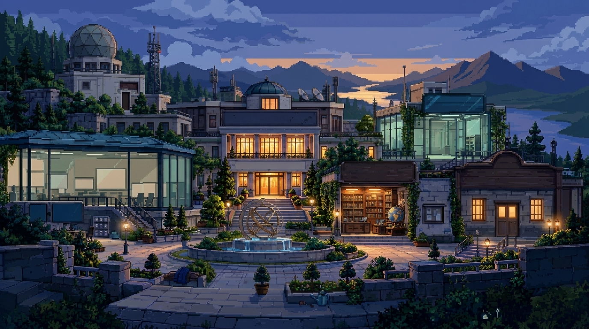

# R08 — атмосфера, растительность и пилот Архива

**Проект:** 26063: Позывной «Синоптик». **Дата:** 21 ноября 2026 года. **Этап:** продолжение генерации и сохранения по визуальному плану. **Задача:** `R08-HUB-PILOT`.

## Результат

В SpriteCook сохранены **15 новых ресурсов**: пять результатов генерации и десять отдельных деталей. Они добавлены в существующую коллекцию **R08 — цельная площадь и атмосфера · 2026-11-21** проекта **26063: Позывной «Синоптик» — MVP**. Вместе с пятью ресурсами предыдущего этапа манифест R08 учитывает 20 ресурсов. Точные идентификаторы, размеры, хеши и ограничения находятся в [манифесте кандидатов](../../../../manifests/hub.r08-candidates.json).

Подготовлен отдельный игровой предпросмотр `/art/r08`. Он использует исходную композицию, точные слои Архива, переднее перекрытие, существующего наблюдателя и управляемые световые области. Главная страница `/` сохраняет прежнюю сцену. Предпросмотр собирается и проходит проверки кода; фактическая браузерная приёмка заблокирована средой.

Наиболее выразительный результат нового этапа — **вечерний этюд**. Независимый художественный руководитель принял его как направление освещения: холодная глубина среды, тёплый центральный вход, обитаемый архив и более спокойные второстепенные помещения. Это ориентир для сборки света, а не кадр работающей игры.

## 1. Что сгенерировано

Все пять операций выполнены моделью `gemini-nano-banana-2.1`, в запрошенном режиме `1K`, с включённой пиксельной обработкой. Размеры ниже измерены в полученных файлах; параметры запроса являются подсказкой провайдеру и не определяют точную сетку результата.

| Ресурс | Канонический PNG | Исходник провайдера | Решение |
| --- | --- | --- | --- |
| [Дневной материал 02](candidates/provider/day-material-02.png) | 512×288 | JPEG 1376×768 | Сравнительный этюд. Улучшения недостаточны для замены основы; появились изменённые струи фонтана |
| [Вечернее освещение 01](candidates/provider/dusk-lighting-study-01.png) | 512×288 | JPEG 1376×768 | Принято как световое направление пилота; целиком под старые вырезки не подставляется |
| [Растительность 01](candidates/provider/vegetation-sheet-01.png) | 203×200 | JPEG 1024×1024 | Пять перспективных растений и четыре составные детали; масштаб и размещение требуют проверки |
| [Стыки земли 01](candidates/provider/terrain-connections-sheet-01.png) | 240×240 | JPEG 1024×1024 | Отклонено для размещения: высокая блочная геометрия, тяжёлые контуры и другой ракурс |
| [Органичные стыки 02](candidates/provider/organic-ground-seams-02.png) | 200×200 | JPEG 1024×1024 | Материалы и края улучшены. Выбрана одна нерегулярная группа для локальной пробы; весь лист не принят |

Первый набор стыков сохранён с причиной отклонения. Его автоматическое уменьшение не решило бы проблему: важны одновременно наклон плоскостей, высота бордюра, характер края и отношение к человеку. Исправленная генерация убрала тяжёлую обводку и высокий срез грунта, но часть объектов всё ещё имеет форму отдельных островков. Массовое размещение таких островков вернуло бы эффект наклеенных оснований.

Полные промпты, reference/edit IDs, задания провайдера и расходы сохранены в [журнале этапа 2](generation-log-phase2.json). Исходники провайдера сохранены без изменения байтов.

## 2. Какие отдельные детали сохранены

Девять объектов растительного листа бесплатно разделены и переименованы в SpriteCook. Нарезка выполнена по фактическим границам изображения, а не по предположению о равных ячейках. Все **10 871 видимый пиксель** исходного листа сохранились с точными значениями RGB и alpha, включая мелкие отделённые фрагменты.

| Деталь | Размер PNG | Назначение и ограничение |
| --- | --- | --- |
| [Вертикальный куст](candidates/slices/vegetation/upright-shrub.png) | 45×48 | Проба растительного объёма; сначала согласовать размер относительно человека |
| [Низкий куст](candidates/slices/vegetation/low-shrub.png) | 60×39 | Проба среднего плана и края дорожки |
| [Молодая сосна](candidates/slices/vegetation/young-pine.png) | 32×62 | Отдельное дерево с видимым основанием; масштаб не утверждён |
| [Берёза](candidates/slices/vegetation/birch-sapling.png) | 35×60 | Отдельное дерево; проверить соответствие окружающей растительности |
| [Плющ со стенкой](candidates/slices/vegetation/wall-ivy.png) | 46×49 | Составной фрагмент, не свободно подвешиваемый плющ |
| [Папоротник](candidates/slices/vegetation/fern-clump.png) | 52×49 | Проба низкой растительности; нельзя автоматически трактовать пиксели как единицы мира |
| [Цветник](candidates/slices/vegetation/flower-bed.png) | 56×37 | Растения вместе с каменным бортиком; нуждается в совмещении с землёй |
| [Каменный угол со мхом](candidates/slices/vegetation/mossy-stone-corner.png) | 49×42 | Составной элемент, направление и опорная поверхность требуют согласования |
| [Осока у влажного камня](candidates/slices/vegetation/sedge-stone-edge.png) | 43×48 | Растение вместе с влажным основанием; не универсальный куст |
| [Земля, камни и листья](candidates/slices/ground/loose-leaves-and-pebbles.png) | 53×29 | Выбранный элемент №8 исправленного листа; допускается к локальной пробе стыка |

Последний фрагмент вырезан по прямоугольнику `(74,146,53,29)`. Сохранены все **840 непрозрачных пикселей**, включая две маленькие отдельные группы. Обнулён только RGB полностью прозрачных пикселей. После импорта в SpriteCook результат скачан и сравнён с локальным файлом: декодированный RGBA совпадает полностью. Серверная перепаковка PNG изменила байтовый хеш, что записано в [проверке импорта](../../../../../docs/testing/evidence/hub-r08/phase2-ground-import-verification.json).

Происхождение всех десяти деталей: [slicing-provenance.json](candidates/slices/slicing-provenance.json). Независимая проверка листов: [phase2-sheet-validation.json](../../../../../docs/testing/evidence/hub-r08/phase2-sheet-validation.json). Прозрачные края просмотрены на светлой и тёмной подложках; техническая прозрачность не подменяет проверку масштаба и художественного стиля.

## 3. Что подготовлено в игровом пилоте

Предпросмотр находится в отдельном маршруте `/art/r08`. Для существующего репозитория сначала выполняется `python3 tools/assets/build_hub_r08.py`, затем обычный запуск веб-приложения. Точный контракт и исходники реализации приведены в [описании игровой сборки](../../../../../packages/world-engine/src/runtime/README.md).

- **Единая геометрия:** исходник 512×288 переносится в мир 960×540 одним преобразованием ×1,875. Фасад, ступени, фонарь и передний план не подгоняются отдельно.
- **Локальная подложка:** донор заменяет только 4021 пиксель маски фасада. За её пределами изменений нет. Возврат исходных слоёв точно восстанавливает мастер.
- **Наблюдатель:** используется существующий персонаж высотой 48 единиц мира с исходными покоем и ходьбой. Есть маршрут и фиксированные положения перед Архивом и за кустом/оградой.
- **Глубина:** передний фрагмент взят из той же композиции и получает свою линию перекрытия. Он не считается независимо переносимым растением.
- **Освещение:** восемь локальных областей управляют главным входом, верхними окнами, Архивом, двумя лабораториями, залом, фонарём и отражённым светом на камне. Полные генеративные дневной/вечерний кадры не переключаются.
- **Управление:** доступны общий вид, крупный план Архива, уменьшенное движение, экономия ресурсов и вход в существующую читальню. Возврат из неё в пилот принимается только по точному разрешённому адресу.

Независимая проверка выявила захваты листвы и переплёта световыми масками. Контуры исправлены и повторно просмотрены. Приняты **контуры и локальность**, а не окончательная яркость света в работающей сцене.

Также исправлен резервный режим без WebGL. В нём Phaser не применяет используемое окрашивание изображений, поэтому пилот показывает день; кнопка сумерек недоступна с объяснением. Защита установлена и в самой сцене, чтобы не появлялись белые неокрашенные световые маски.

Экспорт содержит **9 PNG**, 681 103 байта изображений. Расчётный объём RGBA — 2 979 396 байт без накладных расходов GPU и буферов. Это характеристика ресурсов, а не измерение производительности игры.

## 4. Проверки и границы результата

| Проверка | Результат |
| --- | --- |
| TypeScript веб-приложения | Пройдено, включая исправление резервного режима |
| Производственная сборка Vite | Пройдено; предупреждение о размере общего блока движка сохраняется |
| Контракт, координаты, DPR, глубина, безопасный возврат | Шесть проверок пройдены |
| Воспроизводимость экспорта и точное восстановление мастера | Пройдено |
| Репозиторий, архитектура, бренд, шрифты, контракты и манифесты ресурсов | Пройдено; три прежних предупреждения относятся к отсутствующим исходникам других UI-кандидатов |
| Независимый обзор кода и конвейера | Пройден для изолированного кандидата; найденное замечание резервного режима закрыто в коде |
| Художественная проверка этюдов, деталей и контуров масок | Проведена с отдельными решениями, перечисленными выше |
| Фактическая картинка, мышь/клавиатура, мобильная компоновка, кадровое время | Не подтверждены: браузерный запуск заблокирован средой |

Локальный Chromium остановился до открытия страницы из-за ограничения создания системного сокета. Облачный браузер не достиг локального порта, затем доступ к ошибочной вкладке был запрещён политикой URL. Обходы ограничений не выполнялись. Диагностические изображения в пакете — статические проверки исходников и масок, не снимки игры из браузера.

Итоговые протоколы: [художественный обзор](../../../../../docs/art/reviews/2026-11-21-hub-r08-pilot-review.md), [независимый обзор кода](../../../../../docs/testing/evidence/hub-r08/phase2-independent-code-review.md), [проверка итогового пакета](../../../../../docs/testing/evidence/hub-r08/phase2-validation.json).

## 5. Что требуется для желаемой цельности и выразительности

**Сначала — один законченный участок Архива.** Проверить фрагмент земли и выбранные растения непосредственно у существующего основания: свет, ракурс, плотность пикселей, опора на землю и отношение к человеку. Не переносить весь лист в сцену одним решением. Рабочие детали затем становятся образцом для остальных зданий.

**Зафиксировать производственную сетку и семейства масштаба.** Текущее увеличение ×1,875 разрешено только для пилота. Высокодетализированный куст и маленький фасад нельзя считать сопоставимыми только из-за количества пикселей в файлах. Нужны согласованные размеры дерева, человека, двери, бордюра и ступени на одном кадре.

**Довести свет до принятого вечернего этюда.** Следующий пакет должен добавить отдельные теневые плоскости и отражения, сохранить тёмные оконные переплёты и сделать свет главного входа важнее верхних окон. Архив остаётся вторым тёплым акцентом; лаборатории и зал получают собственный, более спокойный характер. Общая заливка и одинаковый свет всех окон этого не обеспечат.

**После приёмки участка продолжить остальные фасады.** Сохранять общую композицию, террасы и горы. У каждого входа соединять основание, порог, дорожку, растительность, контактную тень и локальный свет; проверять перекрытие персонажем. Не повторять генерацию самостоятельных зданий с разными камерами и случайными подставками.

**Жизнь добавлять разными темпами.** Подготовить воду фонтана, небольшие движения растений, облака и редкие действия окружающих персонажей. Сначала проверить их в одной камере и в режиме уменьшенной анимации. Персонажи не требуют массовой перегенерации до проверки их существующего размера рядом с принятым участком.

Качество уровня заявленного пользователем ориентира оценивается по цельной работающей сцене, материалам, свету, движению и управлению. Этот этап даёт проверяемые исходники и пилот, но не является финальной художественной приёмкой всей игры.

## 6. Расходы, сохранение и ответственность

| Показатель | Кредиты |
| --- | ---: |
| Проверенный баланс перед этапом | 561 |
| Пять генераций по 12 | 60 |
| Нарезка, переименование и импорт | 0 |
| Проверенный остаток после сохранения | **501** |

Незавершённых заданий SpriteCook нет. Расход **21 кредит** предыдущего этапа учитывается отдельно и в эти 60 не входит. Новые задания на 2K/4K не запускались; использован доступный режим 1K.

Проект SpriteCook: `f62cc12d-b463-4c6b-8550-f82ee24b29a3`. Коллекция: `e5f39008-fe78-41f6-b1a9-7a756d57cb45`. Все 15 новых ресурсов подтверждённо назначены в неё. Временные ссылки скачивания и токены загрузки в сохранённые журналы и манифесты не входят.

Ветка работы: `agent/pixel-asset-designer/hub-r08-candidates`, исходный коммит этапа `9875c93141eb376e883efbf888403fdea21e6050`. Изменения подготовлены отдельно; публикация в GitHub и замена основной сцены не выполнялись.

Ответственные: `/root` — генерации, сохранение, происхождение, итоговый пакет и исправление резервной отрисовки; `/root/spritecook_plan` — игровая сцена; `/root/asset_inventory` — конвейер и независимая проверка новых листов; `/root/render_audit` — независимое художественное решение; `/root/integration_review` — независимая проверка кода и конвейера. Дальнейший производственный допуск требует реальной браузерной проверки, художественной приёмки, проверки пиксельной графики, доступности управления и производительности.
