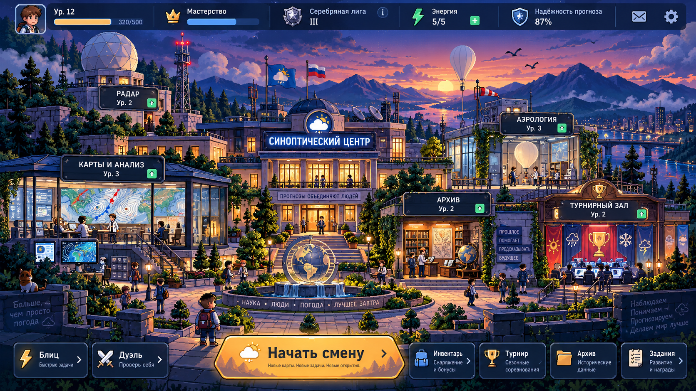

# Эталонные экраны V2 (5 ноября 2026 года)

**Назначение:** неизменённые изображения, переданные владельцем проекта, — художественные ориентиры для игры «26063: Позывной „Синоптик“». Все изображения имеют размер 1672×941, формат PNG; контрольные суммы SHA-256 перечислены в [manifest.json](manifest.json). Эти файлы **не используются напрямую как игровые полноэкранные фоны**.

| Файл | Экран | Что требуется воспроизвести |
|---|---|---|
| [01_hub.png](01_hub.png) | **Главный кампус (главный эталон первого экрана)** | Многоплановый научный кампус на закате, единая перспектива, разный силуэт каждого корпуса, тёплые окна, вода и небо, главный призыв «Начать смену», ограниченное число постоянных панелей |
| [02_blitz.png](02_blitz.png) | Блиц | Карта в центре внимания, таймер, выбор ответов, поддержка наставника, короткий отклик |
| [03_duel.png](03_duel.png) | Синоптическая дуэль | Симметричное соперничество, единое поле анализа, операции, карта, понятные результаты |
| [04_inventory.png](04_inventory.png) | Инвентарь | Крупный портрет персонажа, научные инструменты, узнаваемые предметы, организация иерархии |
| [05_tournament.png](05_tournament.png) | Турнир | Командное соперничество, читаемое табло, сцена, зрители, календарь событий |
| [06_progression.png](06_progression.png) | Сезон и развитие | Сезонный путь, компетенции, открытие помещений, значимые награды |

## Применение

1. Художественный контракт и границы допустимой интерпретации: [SCREEN_REFERENCE_SET_V2_20261105.md](../../../docs/design/SCREEN_REFERENCE_SET_V2_20261105.md).
2. План первого экрана, этапы и независимая приёмка: [HUB_V2_FIRST_SCREEN_20261105.md](../../../docs/roadmap/HUB_V2_FIRST_SCREEN_20261105.md).
3. Проектные ограничения: [BRAND_AND_LORE_26063.md](../../../docs/BRAND_AND_LORE_26063.md) и [HUB_VISUAL_ACCEPTANCE.md](../../../docs/design/HUB_VISUAL_ACCEPTANCE.md).
4. Проверка исходных файлов: `python tools/validate_visual_refs_v2.py`.

## Критические ограничения

- **Профессиональная достоверность:** изображение концепта не является источником метеорологических данных. Фронты, изобары, значения и сроки формируются нормативным модулем.
- **География:** горные хребты на концептах не переносятся в канонический мир Северо-Запада и Финского залива.
- **Тексты:** ошибки и неестественные надписи в исходном рисунке не являются утверждёнными. В игровых сценах шрифты и подписи создаются отдельно, на русском языке.
- **Производство:** визуальные элементы собираются как модульные текстуры, геометрия, анимации и React-интерфейс; сохранённые изображения служат постоянной базой для художественного сравнения.
