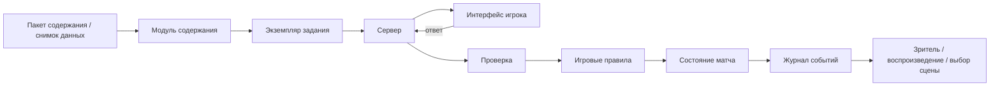
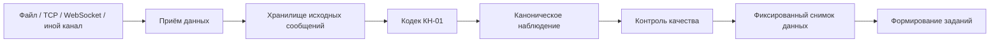

# Архитектура проекта

**Статус:** предложено

Этот раздел описывает целевую модульную архитектуру. Технологический стек может меняться; доменные границы должны оставаться стабильными.

## 1. Целевая структура единого репозитория компонентов

```text
apps/
├── web/                 # основной браузерный интерфейс игрока
├── server/              # REST + сетевые матчи + авторитетное состояние
├── display/             # автономный большой экран
└── tools/               # служебные средства, импорт и подготовка данных

packages/
├── meteorology-domain/  # предметные сущности и термины
├── kn01-codec/          # версионируемое кодирование/дешифрирование КН-01
├── live-ingest/         # приём актуальных данных, удаление дублей, карантин
├── content-schema/      # схемы и проверка учебного содержания
├── content-engine/      # загрузка пакетов и формирование заданий
├── game-rules/          # детерминированные игровые правила
├── realtime-protocol/   # события и сетевые контракты
├── broadcast-selector/  # выбор сцены большого экрана
├── world-engine/        # время суток, сезоны, фоновые события, находки
├── identity/            # список пользователей, вход, роли, сессии
├── rewards/             # достижения, предметы оформления, инвентарь
├── map-engine/          # схемы станций, фронты, линии, наложения
├── replay/              # журнал событий и воспроизведение
├── ui/                  # общие компоненты интерфейса
└── analytics-domain/    # освоение навыков, попытки, показатели группы

content/
├── sources/
├── method-profiles/
├── skills/
├── packs/
├── tasks/
├── scenarios/
├── cosmetics/
└── balance/

tests/
├── unit/
├── integration/
├── e2e/
└── content/
```

Названия каталогов и пакетов остаются английскими как программные идентификаторы. Их назначение описывается по-русски.

## 2. Главные границы

### `meteorology-domain`

Не знает о React, рейтинге, соревновательных эффектах или базе данных. Содержит типы наблюдений, кодов, карт, фронтов, уровней АТ/ОТ и идентификаторы терминологии.

### `kn01-codec`

Знает правила конкретного `kn01_ruleset_id`, умеет дешифрировать, кодировать и выполнять проверку обратного преобразования. Не знает об интерфейсе, рейтинге и матчах.

### `live-ingest`

Принимает метеотелеграммы из папки, сетевого потока и других адаптеров, хранит исходные сообщения, удаляет дубли, проверяет время и станцию и передаёт нормализованные данные дальше. Не решает игровой баланс.

### `content-engine`

Из `TaskDefinition` или проверенного актуального наблюдения создаёт проверяемый `TaskInstance`. Не определяет силу игрового эффекта.

### `game-rules`

Не знает, что такое КН-01 или атмосферный фронт. Работает с абстрактным результатом задания и параметрами баланса.

### `world-engine`

Управляет временем суток, сезоном, фоновыми событиями, интерактивными объектами и «Находками мира». Не генерирует учебные наблюдения и не меняет метеорологические данные задания.

### `broadcast-selector`

Читает состояния матчей и журнал событий и выбирает сцену для большого экрана. Не имеет права менять результат матча.

### `identity`

Управляет закрытым списком пользователей, кодами входа, ролями и сессиями. Публичная саморегистрация отсутствует.

### `rewards`

Управляет схемой персонажа, предметами оформления, достижениями и происхождением наград. Не может изменять силу игрока в рейтинговом матче.

### `map-engine`

Рисует и проверяет геометрию, но не определяет методическую истинность без данных методического профиля и учебного пакета.

### `server`

Авторитетен для матчей, таймеров, ответов, рейтинга, прав пользователя и публикации учебного содержания.

### `web`

Отвечает за представление и ввод. Правильный ответ до проверки сервером не хранится в клиенте.

### `display`

Клиент большого экрана только для чтения. Автоматически подключается к состоянию трансляции и не требует преподавателя-оператора.

## 3. Основной поток задания



## 4. Поток актуальных КН-01



Внешний источник не должен быть синхронной зависимостью каждого вопроса. Матч всегда работает на зафиксированном снимке и конкретной версии правил.

## 5. Поток живого мира

```text
серверное время / сезон / профиль местоположения / зерно событий
                        ↓
                  world-engine
                        ↓
состояние центра + расписание фоновых событий + находки
                        ↓
                 web / display
```

Покадровая анимация выполняется локально. Сервер не передаёт координату каждой птицы на каждом кадре.

## 6. Автономный большой экран

```text
Активные матчи ─┐
Состояние турнира ├─> broadcast-selector ─> состояние показа ─> display
Журнал событий  ─┤
Таблица лидеров ─┤
Повторы         ─┘

Нет активного матча ─> демонстрационный режим / живой мир
```

## 7. Версионирование

Независимо версионируются:

- схема учебного содержания;
- методические профили;
- наборы правил КН-01;
- снимки актуальных данных;
- пакеты заданий;
- игровые правила;
- профили баланса;
- сетевой протокол;
- формат воспроизведения;
- профиль событий живого мира;
- каталог предметов оформления.

Воспроизведение матча обязано хранить версии, необходимые для точного восстановления старого состояния.

## 8. Запрещённые зависимости

- `meteorology-domain` → пользовательский интерфейс;
- `meteorology-domain` → игровой баланс;
- `live-ingest` → сила игрового эффекта;
- `world-engine` → учебный ответ;
- `broadcast-selector` → изменение состояния матча;
- `rewards` → рейтинговая сила;
- `content` → конкретные клиентские компоненты;
- `web` → секретные ответы;
- `display` → административные секреты;
- `game-rules` → конкретные учебники;
- `replay` → текущая версия баланса без манифеста;
- методические коэффициенты → жёсткие константы пользовательского интерфейса.

## 9. Области API

```text
/auth
/roster
/avatar
/rewards
/courses
/content
/live-data
/tasks
/progress
/matches
/tournaments
/replays
/leaderboards
/broadcast
/world
/admin/roster
/admin/content
```

Пути API являются техническим контрактом и не переводятся. Сетевые матчи и большой экран могут использовать отдельные пространства событий и каналы передачи.

## 10. Пользователи и закрытый список

Саморегистрация отсутствует.

```text
администратор / импорт → список → профиль пользователя → быстрый вход → сессия
```

Короткие коды из 1–2 символов разрешаются только в локальном доверенном профиле с ограничением числа попыток и временной блокировкой. Публичный профиль требует усиленной аутентификации.

## 11. Принцип автономной работы

Основной рабочий контур не зависит от присутствия преподавателя.

Автоматически работают:

- проверка заданий;
- расчёт освоения навыков;
- подбор соперников;
- продвижение турнира;
- рейтинг;
- приём актуальных КН-01;
- выбор сцены большого экрана;
- формирование повтора и ярких моментов;
- демонстрационный режим.

Интерфейс преподавателя и администратора нужен для настройки, методического контроля и исключительных вмешательств, а не для повседневного запуска игры.

## 12. Принцип вертикального рабочего среза

Каждый крупный модуль проходит полный путь:

`источник → методическое правило → данные → задание → отображение → проверка → журналирование → испытание`.

Для живого мира:

`состояние мира → графический слой → взаимодействие → сохранение → проверка режима уменьшенной анимации`.

Не следует заранее создавать большие подсистемы без работающего пользовательского сценария.

## 13. Архитектурные решения

Любое решение, влияющее более чем на один пакет, оформляется в `docs/decisions/` до существенной реализации.

## 14. Язык архитектурной документации

Пояснения пишутся по-русски. Английские имена сохраняются для путей, пакетов, типов, протоколов и полей данных согласно [`../LANGUAGE_POLICY.md`](../LANGUAGE_POLICY.md).
