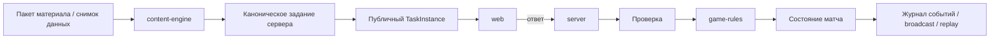

# Архитектура проекта

**Статус:** принято для первого рабочего среза

Цель архитектуры — получить один рабочий вертикальный срез без преждевременного дробления системы. Доменные границы сохраняются, но физически выделяются в отдельные пакеты только там, где это уже даёт пользу.

Ключевые решения: [`ADR-0004`](../decisions/ADR-0004-phaser-webgl-pixel-asset-pipeline.md), [`ADR-0005`](../decisions/ADR-0005-mvp-modular-monolith-boundaries.md) и [`ADR-0007`](../decisions/ADR-0007-threejs-2-5d-pixel-renderer.md).

Для нового Hub нормативны также:

- [`HUB_2_5D_RENDERER_CONTRACT.md`](HUB_2_5D_RENDERER_CONTRACT.md) — renderer, world definition, camera, materials, environment, performance;
- [`CHARACTER_2_5D_ANIMATION_CONTRACT.md`](CHARACTER_2_5D_ANIMATION_CONTRACT.md) — rig, modular characters, animation cadence, attachments;
- [`../design/PIXEL_3D_STYLE_CONTRACT.md`](../design/PIXEL_3D_STYLE_CONTRACT.md) — визуальный язык и pixel pipeline;
- [`../roadmap/HUB_2_5D_MIGRATION.md`](../roadmap/HUB_2_5D_MIGRATION.md) — поэтапная миграция и quality gates.

## 1. Каноническая структура

```text
apps/
├── web/                 # React, маршруты, GameWorld mount, карта SVG/Canvas, /arena-tv
└── server/              # авторитетный модульный монолит

packages/
├── kn01-codec/          # чистый версионированный кодек КН-01 без ввода-вывода
├── content-engine/      # формирование заданий и серверная проверка
├── game-rules/          # детерминированные игровые правила
├── world-engine/        # Phaser lifecycle + WebGL + Three.js 2.5D Hub renderer
└── contracts/           # версионированные структуры обмена и схемы

assets/
├── source/              # редактируемые исходники
├── scenes/              # legacy/Tiled scenes там, где они ещё используются
├── manifests/           # identifiers, anchors, animation/provenance metadata
└── generated/           # производные ресурсы; ручная правка запрещена

tools/
└── assets/              # проверка и упаковка графических ресурсов

content/
├── sources/
├── method-profiles/
├── skills/
├── packs/
├── tasks/
├── scenarios/
├── cosmetics/
└── balance/
```

До отдельного архитектурного решения не создаются `apps/display`, `apps/spectator`, а также отдельные пакеты `meteorology-domain`, `live-ingest`, `content-schema`, `realtime-protocol`, `broadcast-selector`, `identity`, `rewards`, `map-engine`, `replay`, `ui` и `analytics-domain`.

Three.js renderer остаётся модулем `packages/world-engine`, а не новым top-level package: у него пока нет независимого потребителя вне живого мира.

## 2. Границы приложений

### `apps/web`

React отвечает за навигацию, формы, доступность, панели и обычный интерфейс. `GameWorld` монтирует изолированную область живого мира. Профессиональная карта находится в `apps/web/src/features/map` и использует SVG/Canvas.

Маршрут `/arena-tv` является тем же веб-приложением с ролью `display`. Он получает только публичное состояние трансляции и не содержит правильные ответы, коды входа или административные данные.

### `apps/server`

Сервер авторитетен для задания, срока ответа, проверки, матча, рейтинга, прав, наград и публикации учебного материала.

На первом этапе внутри сервера остаются модули:

- `identity`;
- `live-ingest`;
- `realtime`;
- `broadcast`;
- `replay`;
- `rewards`.

Модуль выделяется в отдельный пакет только после появления устойчивой границы и независимого повторного использования.

## 3. Границы пакетов

### `kn01-codec`

Чистые функции разбора, кодирования и контроля согласованности по явному `kn01_ruleset_id`. Пакет не выполняет сетевой ввод-вывод и не знает о матчах.

### `content-engine`

Загружает проверенные пакеты учебного материала, создаёт серверное каноническое задание, формирует публичный `TaskInstance` и проверяет ответ. Эталон не передаётся клиенту.

Для вариантов и последовательностей применяется детерминированная серверная перестановка по зерну раунда. Обратное соответствие хранится только на серверной стороне.

### `game-rules`

Чистый автомат вида `(state, action) -> nextState`. Он работает с абстрактным результатом задания и не знает правил КН-01 или конкретного учебника.

### `world-engine`

Пакет владеет lifecycle живого мира, Phaser integration, WebGL, camera/viewport helpers, loading, audio/animation integration, effects и diagnostic primitives.

Для нового Hub внутри того же пакета используется Three.js 2.5D renderer. Он получает renderer-independent world definition и world state, но не становится источником gameplay truth.

`world-engine` не определяет правильный метеорологический ответ и не является источником состояния матча.

### `contracts`

Версионированные структуры обмена между клиентом, сервером и воспроизведением: события, публичные представления, канонические структуры наблюдений и схемы. Бизнес-логика запрещена.

## 4. Геометрия синоптической карты

Эталон геометрического ответа хранится не в экранных пикселях, а в нормализованном пространстве бланка:

```text
x: 0..1000
y: 0..1000
```

Преобразование экранных координат в пространство бланка выполняется на клиенте до отправки ответа. Сервер проверяет ответ в единицах карты, поэтому телефон, ноутбук и проектор дают один результат.

Для изобар и фронтов проверяется не совпадение с единственной нарисованной кривой, а совокупность условий: допустимый коридор, непрерывность, пересечения, локальная интерполяция, согласование с полем давления и ветра, фронтальный и орографический контекст.

## 5. Основной поток задания



## 6. Поток актуальных КН-01

```text
внешний источник
  ↓
server/live-ingest
  ↓
неизменяемое исходное сообщение
  ↓
kn01-codec
  ↓
каноническое наблюдение + контроль качества
  ↓
фиксированный снимок данных
  ↓
content-engine
```

Внешний источник не является синхронной зависимостью каждого вопроса. Начатый матч работает на фиксированном снимке и конкретных версиях правил.

## 7. Живой мир и графические ресурсы

### 7.1 Новый Hub

Новый Hub строится по принципу world-definition-first:

```text
world/game state
      ↓
HubWorldDefinition
      ↓
Three.js geometry + characters + materials + environment
      ↓
low-resolution pixel pipeline
      ↓
Phaser UI/HUD
```

Каноническое пространство Hub — 640×360. Default internal 3D render target — 320×180. Камера фиксированная orthographic. Сезон, погода, время суток и progression реализуются состояниями materials/lighting/particles, а не обязательным набором полноэкранных raster variants.

### 7.2 2D и legacy assets

Для UI, portraits, documents, icons и legacy scenes сохраняется reproducible asset pipeline:

```text
assets/source + assets/manifests + assets/scenes where applicable
                 ↓
             tools/assets
                 ↓
          assets/generated
                 ↓
        packages/world-engine / apps/web
```

Полноэкранный концепт-арт не используется как готовый фон сцены. AI-generated Hub batches после принятия 2.5D renderer могут сохраняться как art-direction references, если runtime state уже выражается кодом/материалами.

## 8. Персонажи нового Hub

Человекоподобные персонажи используют shared low-poly skeleton family, shared animation library, modular clothing/accessories и palette slots.

Gameplay position остаётся авторитетной; root motion не управляет перемещением. Visual facing по умолчанию может quantize к 8 направлениям. Pose animation намеренно работает с более низкой частотой, чем world renderer, чтобы сохранять sprite-like cadence.

## 9. Запрещённые зависимости

- `world-engine` → правильный учебный ответ;
- Three.js renderer → server/gameplay truth;
- game rules → mesh/material/bone IDs;
- `game-rules` → конкретные правила КН-01;
- `contracts` → бизнес-логика;
- `web` → секретный эталон ответа;
- `/arena-tv` → приватные данные пользователя;
- `assets/generated` → ручная правка как источник истины;
- внутренние серверные модули → прямой импорт из React, Phaser или Three.js;
- учебный материал → конкретный компонент интерфейса;
- gameplay interaction → renderer UUID.

## 10. Критерий выделения нового пакета

Новый пакет создаётся только если одновременно выполняются условия:

1. есть не менее двух независимых потребителей;
2. программный интерфейс уже стабилен;
3. граница уменьшает, а не увеличивает связанность;
4. нет циклической зависимости;
5. решение зафиксировано отдельным ADR.

До этого Three.js Hub renderer остаётся модулем `packages/world-engine`.
