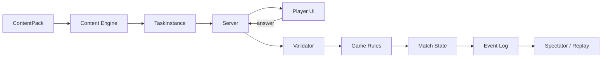

# Архитектура проекта

**Статус:** proposed

Этот раздел описывает целевую модульную архитектуру. Технологический стек может меняться; доменные границы должны оставаться стабильными.

## 1. Целевая структура monorepo

```text
apps/
├── web/                 # основной student UI
├── server/              # REST + realtime + authoritative game state
└── tools/               # content authoring / import / maintenance

packages/
├── meteorology-domain/  # предметные сущности и термины
├── content-schema/      # схемы и валидаторы контента
├── content-engine/      # загрузка пакетов и генерация task instances
├── game-rules/          # deterministic scoring, OR, reliability, effects
├── realtime-protocol/   # события и wire contracts
├── map-engine/          # station plots, fronts, lines, overlays
├── replay/              # event log + deterministic playback
├── ui/                  # design system и общие компоненты
└── analytics-domain/    # mastery, attempts, group metrics

content/
├── sources/
├── method-profiles/
├── skills/
├── packs/
├── tasks/
├── scenarios/
└── balance/

tests/
├── unit/
├── integration/
├── e2e/
└── content/
```

## 2. Главные границы

### `meteorology-domain`
Не знает о React, рейтинге, PvP-уроне или БД. Содержит типы наблюдений, кодов, карт, фронтов, уровней АТ/ОТ и терминологические ID.

### `content-engine`
Знает, как из `TaskDefinition` получить проверяемый `TaskInstance`, но не решает, сколько урона он наносит.

### `game-rules`
Не знает, что такое КН-01 или фронт. Работает с абстрактным результатом задания и метаданными баланса.

### `map-engine`
Рисует и проверяет геометрию, но не решает методическую истинность без данных из content pack.

### `server`
Авторитетен для матчей, таймеров, ответов, рейтинга и публикации контента.

### `web`
Представление и ввод. Правильный ответ до проверки сервером не хранится.

## 3. Основной поток задания



## 4. Версионирование

Независимо версионируются:

- content schema;
- method profiles;
- content packs;
- game rules;
- balance profiles;
- realtime protocol;
- replay format.

Replay обязан содержать версии, необходимые для воспроизведения старого матча.

## 5. Запрещённые зависимости

- `meteorology-domain` → UI;
- `meteorology-domain` → game balance;
- `content` → клиентские компоненты;
- `web` → секретные ответы;
- `game-rules` → конкретные учебники;
- `replay` → текущая версия баланса без manifest;
- методические коэффициенты → hardcode в UI.

## 6. API domains

```text
/auth
/courses
/content
/tasks
/progress
/matches
/tournaments
/replays
/leaderboards
/admin/content
```

Realtime — отдельный namespace/transport.

## 7. Принцип vertical slice

Каждый новый крупный модуль проходит полный путь:

`source → method rule → content → renderer → validation → telemetry → test`.

Не создавать заранее крупные подсистемы без работающего пользовательского сценария.

## 8. ADR

Любое решение, влияющее более чем на один пакет, оформляется в `docs/decisions/` до существенной реализации.
