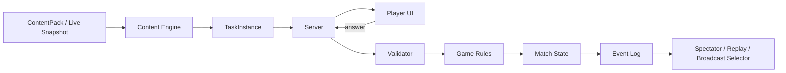
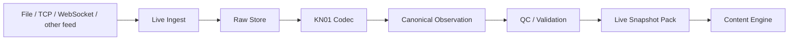

# Архитектура проекта

**Статус:** proposed

Этот раздел описывает целевую модульную архитектуру. Технологический стек может меняться; доменные границы должны оставаться стабильными.

## 1. Целевая структура monorepo

```text
apps/
├── web/                 # основной student UI
├── server/              # REST + realtime + authoritative game state
├── display/             # autonomous Arena TV / kiosk / projector
└── tools/               # content authoring / import / maintenance

packages/
├── meteorology-domain/  # предметные сущности и термины
├── kn01-codec/          # versioned parser/encoder КН-01
├── live-ingest/         # file/socket adapters, raw feed, dedup, quarantine
├── content-schema/      # схемы и валидаторы контента
├── content-engine/      # загрузка пакетов и генерация task instances
├── game-rules/          # deterministic scoring, OR, reliability, effects
├── realtime-protocol/   # события и wire contracts
├── broadcast-selector/  # выбор live match / replay / attract scene
├── world-engine/        # time-of-day, seasons, ambient events, discoveries
├── identity/            # roster, classroom login, roles, sessions
├── rewards/             # achievements, cosmetics, avatar inventory
├── map-engine/          # station plots, fronts, lines, overlays
├── replay/              # event log + deterministic playback
├── ui/                  # design system и общие компоненты
└── analytics-domain/    # mastery, attempts, group metrics

content/
├── sources/
├── method-profiles/
├── skills/
├── packs/
├── tasks/
├── scenarios/
├── cosmetics/
└── balance/

tests/
├── unit/
├── integration/
├── e2e/
└── content/
```

## 2. Главные границы

### `meteorology-domain`
Не знает о React, рейтинге, PvP-уроне или БД. Содержит типы наблюдений, кодов, карт, фронтов, уровней АТ/ОТ и терминологические ID.

### `kn01-codec`
Знает правила конкретного `kn01_ruleset_id`, умеет parse/encode/round-trip validation. Не знает о UI, рейтинге и матчах.

### `live-ingest`
Принимает метеотелеграммы из папки, socket/feed и других адаптеров, хранит raw payload, делает dedup/timestamp/station resolution и передаёт нормализованные данные в codec/content pipeline. Не решает учебный баланс.

### `content-engine`
Знает, как из `TaskDefinition` или validated live observation получить проверяемый `TaskInstance`, но не решает, сколько урона он наносит.

### `game-rules`
Не знает, что такое КН-01 или фронт. Работает с абстрактным результатом задания и метаданными баланса.

### `world-engine`
Управляет временем суток, сезоном, ambient seed, интерактивными объектами и discoveries. Не генерирует учебные наблюдения и не меняет meteorological task data.

### `broadcast-selector`
Читает состояния матчей/event log и выбирает, что показывает Arena TV. Не имеет права менять результат матча.

### `identity`
Управляет закрытым roster, classroom PIN/code, ролями и сессиями. Публичная саморегистрация отсутствует.

### `rewards`
Управляет avatar schema, cosmetics, achievements и provenance наград. Не может изменять Ranked power.

### `map-engine`
Рисует и проверяет геометрию, но не решает методическую истинность без данных из content pack.

### `server`
Авторитетен для матчей, таймеров, ответов, рейтинга, roster authorization и публикации контента.

### `web`
Представление и ввод. Правильный ответ до проверки сервером не хранится.

### `display`
Read-only spectator/kiosk клиент. Автоматически подключается к broadcast state и не требует преподавателя-оператора.

## 3. Основной поток задания



## 4. Live КН-01 поток



Внешний feed не должен быть синхронной зависимостью каждого вопроса: матч работает на фиксированном snapshot/version.

## 5. Living World поток

```text
server time / season profile / event seed
            ↓
        world-engine
            ↓
 hub state + ambient schedule + discoveries
            ↓
         web/display
```

Анимации кадров локальны; сервер не стримит координату каждой птицы каждый frame.

## 6. Автономный broadcast

```text
Active Matches ─┐
Tournament State ├─> broadcast-selector ─> broadcast state ─> display app
Event Log       ─┤
Leaderboards    ─┤
Replay Index    ─┘

No active match ─> attract-mode / living world
```

## 7. Версионирование

Независимо версионируются:

- content schema;
- method profiles;
- KN01 rulesets;
- live snapshot packs;
- content packs;
- game rules;
- balance profiles;
- realtime protocol;
- replay format;
- world event profile;
- cosmetic catalog.

Replay обязан содержать версии, необходимые для воспроизведения старого матча.

## 8. Запрещённые зависимости

- `meteorology-domain` → UI;
- `meteorology-domain` → game balance;
- `live-ingest` → game damage/scoring;
- `world-engine` → учебный ответ;
- `broadcast-selector` → изменение match state;
- `rewards` → Ranked power;
- `content` → клиентские компоненты;
- `web` → секретные ответы;
- `display` → admin secrets;
- `game-rules` → конкретные учебники;
- `replay` → текущая версия баланса без manifest;
- методические коэффициенты → hardcode в UI.

## 9. API domains

```text
/auth
/roster
/avatar
/rewards
/courses
/content
/live-data
/tasks
/progress
/matches
/tournaments
/replays
/leaderboards
/broadcast
/world
/admin/roster
/admin/content
```

Realtime match и broadcast могут использовать отдельные namespaces/transports.

## 10. Identity и закрытый roster

Саморегистрация отсутствует.

```text
admin/import → roster → user profile → classroom login → session
```

Короткие 1–2-символьные classroom codes разрешаются только в локальном trusted security profile с rate limiting/lockout. Публичный профиль требует усиленной аутентификации.

## 11. Принцип autonomous-first

Основной runtime не должен зависеть от присутствия преподавателя.

Автоматически работают:

- task validation;
- mastery;
- matchmaking;
- tournament progression;
- rating;
- live KN01 ingestion;
- Arena TV selection;
- replay/highlight generation;
- attract-mode.

Instructor/Admin UI существует для настройки, методического контроля и override, а не как обязательный runtime-оператор.

## 12. Принцип vertical slice

Каждый новый крупный модуль проходит полный путь:

`source → method rule → content/live data → renderer → validation → telemetry → test`.

Для living world:

`world state → sprite/layer → interaction → persistence → reduced-motion test`.

Не создавать заранее крупные подсистемы без работающего пользовательского сценария.

## 13. ADR

Любое решение, влияющее более чем на один пакет, оформляется в `docs/decisions/` до существенной реализации.
