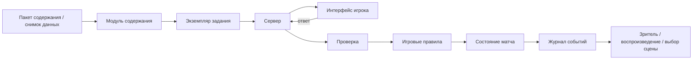
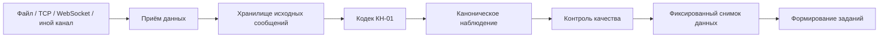

# Архитектура проекта

**Статус:** принято для первого рабочего среза

Этот раздел описывает целевую модульную архитектуру. Доменные границы стабильны; технологические решения, которые уже приняты отдельным ADR, считаются контрактом до их явной замены.

## 1. Целевая структура единого репозитория

```text
apps/
├── web/                 # React-интерфейс игрока
├── server/              # REST + сетевые матчи + авторитетное состояние
├── display/             # автономный большой экран
└── tools/               # общие служебные средства

packages/
├── meteorology-domain/  # предметные сущности и термины
├── kn01-codec/          # КН-01
├── live-ingest/         # актуальные данные
├── content-schema/      # схемы содержания
├── content-engine/      # формирование заданий
├── game-rules/          # детерминированные игровые правила
├── realtime-protocol/   # сетевые контракты
├── broadcast-selector/  # выбор сцены большого экрана
├── world-engine/        # Phaser 4 / WebGL runtime живого мира
├── identity/            # пользователи/сессии
├── rewards/             # достижения/инвентарь
├── map-engine/          # профессиональная геометрия SVG/Canvas
├── replay/              # журнал и воспроизведение
├── ui/                  # React UI components
└── analytics-domain/    # освоение навыков и показатели

assets/
├── source/              # редактируемые .aseprite и authored components
├── scenes/              # Tiled JSON (.tmj/.tsj)
├── manifests/           # semantic IDs, pivots, animations, provenance
└── generated/           # runtime output; manual edit forbidden

tools/
└── assets/              # sprite-tools + AssetPack integration

content/
├── sources/
├── method-profiles/
├── skills/
├── packs/
├── tasks/
├── scenarios/
├── cosmetics/
└── balance/

tests/
├── unit/
├── integration/
├── e2e/
└── content/
```

## 2. Главные границы

### `meteorology-domain`
Не знает о React, Phaser, рейтинге или БД. Содержит типы наблюдений, кодов, карт, фронтов, уровней АТ/ОТ и идентификаторы терминологии.

### `kn01-codec`
Знает конкретный `kn01_ruleset_id`, умеет дешифрировать/кодировать и проверять обратное преобразование. Не знает об UI и матчах.

### `live-ingest`
Принимает внешние данные, хранит raw input, удаляет дубли, проверяет время/станцию и нормализует. Не решает игровой баланс.

### `content-engine`
Из `TaskDefinition` или проверенного наблюдения создаёт проверяемый `TaskInstance`. Не определяет силу игрового эффекта.

### `game-rules`
Работает с абстрактным результатом задания и балансом, не знает конкретный учебник или КН-01.

### `world-engine`
Phaser/WebGL runtime. Отвечает за scene lifecycle, cameras, sprite animation playback, tweens, particles, filters/shaders, asset loading и renderer diagnostics. Сам по себе не определяет время суток, смысл ambient event, учебную истину или серверный результат матча.

### логика живого мира
Состояние времени/сезона, seeded ambient schedules, интерактивные объекты и «Находки мира» реализуются поверх `world-engine` в рамках WORLD-контракта. Сервер передаёт состояние/seed, а не координаты каждого объекта на каждом кадре.

### `map-engine`
Рисует/проверяет профессиональную метеорологическую геометрию через SVG/Canvas. Не переносится в Phaser без отдельного ADR и методико-технической проверки.

### `broadcast-selector`
Читает состояния матчей/журнал и выбирает сцену большого экрана; не меняет результат матча.

### `identity`
Управляет закрытым списком пользователей, входом, ролями и сессиями. Саморегистрации нет.

### `rewards`
Управляет предметами/достижениями; не может менять рейтинговую силу.

### `server`
Авторитетен для матчей, таймеров, ответов, рейтинга, прав и публикации содержания.

### `web`
React-оболочка, ввод и представление. Монтирует Phaser runtime как изолированную игровую область. Не хранит правильный ответ до серверной проверки.

### `display`
Read-only большой экран; подключается к broadcast state и не требует оператора.

## 3. Граница React ↔ Phaser

```text
React application
├── DOM/CSS UI
├── map-engine (SVG/Canvas)
└── GameWorld mount
    └── @synopsis/world-engine
        └── Phaser 4 / WebGL
```

React передаёт в игровой runtime крупнозернистое состояние/команды и получает дискретные события. Перекачка каждого кадра через React state запрещена. Mount/unmount должен освобождать game loop, listeners, textures/resources according to runtime policy.

## 4. Контур графических ресурсов

```text
Aseprite / Pixelorama
        ↓
assets/source + assets/manifests
        ↓
sprite-tools validation/metadata/transforms
        ↓
Tiled scene (.tmj/.tsj) uses semantic asset IDs
        ↓
AssetPack packing/optimisation
        ↓
assets/generated
        ↓
Phaser runtime
```

`design/pixel-art/` — художественные эталоны, а не production runtime assets. `assets/generated` — производный слой; ручная правка запрещена. Базовая схема manifest: `assets/manifests/asset-manifest.schema.json`.

## 5. Поток задания



## 6. Поток актуальных КН-01



Матч всегда работает на фиксированном снимке и конкретной версии правил.

## 7. Поток живого мира

```text
серверное время / сезон / world_location / seed
                     ↓
             WORLD state logic
                     ↓
    phase + event schedule + discoveries
                     ↓
       Phaser/WebGL world-engine locally
                     ↓
                web / display
```

Покадровая анимация локальна. Sprite animation cadence отделена от display FPS: перемещение/camera/tween может идти на частоте дисплея, а sprite frames сохраняют художественно заданный ритм без размывающей интерполяции пикселей.

## 8. Автономный большой экран

```text
Активные матчи ─┐
Состояние турнира ├─> broadcast-selector ─> состояние показа ─> display
Журнал событий  ─┤
Таблица лидеров ─┤
Повторы         ─┘

Нет активного матча ─> демонстрационный режим / живой мир
```

## 9. Версионирование

Независимо версионируются схема содержания, методические профили, КН-01 rulesets, snapshots, task packs, game rules, balance, realtime protocol, replay format, world-event profile, cosmetics catalogue и asset manifest/toolchain contract. Phaser major-version changes оформляются ADR.

## 10. Запрещённые зависимости

- `meteorology-domain` → React/Phaser/UI;
- `meteorology-domain` → игровой баланс;
- `live-ingest` → сила игрового эффекта;
- WORLD/world-engine → учебный ответ;
- Phaser runtime → авторитетное состояние матча;
- `map-engine` → Phaser только ради оформления;
- world logic → generated atlas coordinates;
- `assets/generated` → ручная правка как source-of-truth;
- `broadcast-selector` → изменение матча;
- `rewards` → рейтинговая сила;
- `content` → конкретные клиентские компоненты;
- `web` → секретные ответы;
- `display` → административные секреты;
- `game-rules` → конкретные учебники;
- `replay` → текущий баланс без манифеста.

## 11. Области API

`/auth`, `/roster`, `/avatar`, `/rewards`, `/courses`, `/content`, `/live-data`, `/tasks`, `/progress`, `/matches`, `/tournaments`, `/replays`, `/leaderboards`, `/broadcast`, `/world`, `/admin/roster`, `/admin/content`.

## 12. Пользователи и автономность

Саморегистрация отсутствует. Основной рабочий контур не требует преподавателя-оператора: проверка заданий, прогресс, matchmaking, tournament progression, rating, ingest, broadcast selection, replay/highlights и attract mode автоматизированы.

## 13. Вертикальный рабочий срез

Для учебной функции: `источник → методическое правило → данные → задание → отображение → проверка → журналирование → испытание`.

Для живого мира: `editable asset → manifest → generated asset → Phaser scene → world state → interaction → persistence → reduced-motion/performance verification`.

Большие подсистемы без работающего пользовательского сценария не создаются заранее.

## 14. Архитектурные решения

Сквозные решения оформляются в `docs/decisions/`. Phaser/WebGL и asset pipeline закреплены `ADR-0004`.

## 15. Язык архитектурной документации

Пояснения пишутся по-русски. Английские имена сохраняются для путей, пакетов, типов, протоколов и полей согласно [`../LANGUAGE_POLICY.md`](../LANGUAGE_POLICY.md).
