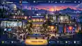
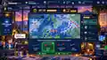
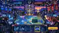
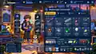
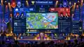
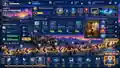

# Руководство по пиксельной графике

**Статус:** принято как художественный эталон

Этот документ фиксирует визуальное направление игры «26063: Позывной „Синоптик“». Он является основой для будущих экранов, иллюстраций, анимаций и реализации интерфейса, пока отдельным архитектурным или художественным решением не утверждено иное.

## 1. Визуальная цель

Игра должна ощущаться как **современная, уютная и качественно выполненная игра в пиксельной графике**, а не как ретро-пародия и не как учебная информационная панель с наложенным «пиксельным фильтром».

Желаемое сочетание ощущений:

- профессиональная компетентность и любопытство;
- атмосфера исследовательского метеорологического кампуса;
- тёплый свет помещений на фоне холодного синего или фиолетового неба;
- ощущение, что центр продолжает жить, даже когда игрок ничего не делает;
- соревновательная энергия без милитаризации;
- небольшие открытия и изменения, ради которых хочется возвращаться.

Главный экран центра задаёт художественный язык. Все остальные экраны являются развитием того же мира.

## 2. Зафиксированные эталонные экраны

### Главный центр



Фиксирует:

- внешний вид мира и кампуса;
- контраст тёплых окон и холодного неба;
- читаемые модульные здания;
- небольших движущихся персонажей и фоновую жизнь;
- иерархию главного действия;
- спокойное визуальное поведение вторичных элементов интерфейса.

### Блиц



Фиксирует:

- композицию «одна задача — один фокус»;
- таймер и серию;
- небольшой список следующих категорий;
- реакцию сопровождающего персонажа;
- короткую и положительную обратную связь.

### Синоптическая дуэль



Фиксирует:

- симметричную соревновательную композицию;
- общую карту как главный объект;
- Надёжность и оперативный ресурс как периферийные показатели;
- парирование, контратаку и серию;
- зрелищность без перекрытия профессиональных данных.

### Инвентарь



Фиксирует:

- постоянную идентичность персонажа;
- тематические инструменты синоптика;
- коллекционный интерфейс;
- персонализацию рабочего места;
- визуальное развитие инструментов.

### Турнир и большой экран



Фиксирует:

- иерархию, читаемую с проектора;
- атмосферу турнира учебной группы;
- командные цвета и ленту важных событий;
- положение турнирной сетки;
- читаемость с нескольких метров.

### Развитие и сезонный путь



Фиксирует:

- причины возвращаться в игру;
- линии освоения навыков;
- карьерное развитие;
- открытие помещений центра;
- сезонные награды и коллекционные предметы.

> Изображения в репозитории служат художественными эталонами. В рабочей версии графика должна быть воссоздана как отдельные слои, наборы кадров и переиспользуемые компоненты, а не использоваться как одна неподвижная картинка.

## 3. Иерархия композиции

Каждый экран игрока следует порядку:

1. **Текущая ситуация, карта или задача** — главный объект.
2. **Одно основное действие** — сразу заметно.
3. **Состояние матча или занятия** — Надёжность, оперативный ресурс, время, серия.
4. **Вторичная навигация и развитие.**
5. **Декоративные детали живого мира.**

Все панели не должны иметь одинаковый визуальный вес.

За три секунды пользователь должен понять:

- что он делает сейчас;
- где нужно действовать;
- насколько успешно идёт работа;
- что интерактивно, а что является фоном.

## 4. Язык пиксельной графики

### 4.1. Современная пиксельная графика, а не имитация низкого разрешения

Используются чёткие группы пикселей, контролируемое сглаживание и осмысленные формы. Случайный одиночный шум не используется.

Рекомендуемый порядок подготовки:

- мир и персонажи строятся на фиксированной логической пиксельной сетке;
- увеличение выполняется целыми коэффициентами там, где это уместно;
- все текстовые надписи, интерфейсы, заголовки и кнопки используют утвержденную локальную систему пиксельных шрифтов с полной кириллицей (`Press Start 2P`, `PixCyrillic`, `PixCyrillic-Dense`);
- профессиональные символы, изобары и фронты карты (SVG/Canvas) остаются математически точными векторными объектами и не размываются ради «псевдопиксельного фильтра».

### 4.2. Язык форм

Мир:

- компактные архитектурные силуэты;
- округлые купола и радары;
- радиомачты, анемометры, радиопрозрачные купола, зонды;
- небольшие деревья, фонари, скамейки, книги и шкафы с картами.

Интерфейс:

- тёмные сине-графитовые панели;
- тонкие внутренние подсветки;
- умеренно скруглённые или скошенные углы;
- чёткие пиктограммы;
- тёплый янтарный акцент для главного действия.

### 4.3. Пиксельная типографика v2 и русифицированные шрифты

Вся типографика игры строится на утвержденных, скачанных локально в проект (`apps/web/public/fonts/` и `assets/fonts/`) пиксельных шрифтах под свободной лицензией SIL Open Font License 1.1 (без внешних зависимостей от CDN). Использование `monospace`, `Inter` или `system-ui` в качестве основной гарнитуры категорически запрещено.

1. **Основной интерфейсный и титульный шрифт: `PixCyrillic` (`var(--font-pixel-ui)`)**
   - **Роль:** Все заголовки экранов (`h1`, `h2`, `h3`), кнопки действий (CTA), вкладки, выпадающие списки, формы ввода, реплики персонажей, описания заданий, карточки инвентаря.
   - **Сетка и характер:** Нативный растр глифов — строго 16 px на кегль. Пропорциональный пиксельный шрифт с органичными скруглениями (эстетика *A Short Hike* / *Celeste*), обеспечивающий высокую читаемость и комфортную скорость чтения связного русского текста.
   - **Символы:** Полный русский алфавит (включая строчные и прописные с диакритикой `Ё`/`ё`), цифры, символы градусов (`°C`), кавычки-ёлочки (`«»`), длинное тире (`—`), знак минуса (`−`).
   - **Кегли по нативной сетке:**
     - Титул экрана / эмблема: `48px` или `64px` (кратность ×3 / ×4 от нативных 16px).
     - Заголовок экрана (h1): `32px` (кратность ×2 от нативных 16px).
     - Основной текст, диалоги, кнопки: `16px` (нативный размер 1:1).

2. **Сверхчеткий шрифт плотного интерфейса: `PixCyrillic-Dense` (`PixCyrillic-AShortHikeEdition`, `var(--font-pixel-dense)`)**
   - **Роль:** Компактные тултипы, маркеры на карте кампуса, плотные таблицы телеметрии, где необходима толщина штриха строго в 1 физический пиксель при сохранении сглаживания.
   - **Кегль:** Строго `16px` (межстрочный интервал 1,375).
   - **Решение по мелким кириллическим подписям:** Для плотных русских подписей используется `PixCyrillic-Dense` в нативном кегле `16px`. Использование неизящных сжатых моноширинных шрифтов с обрезанными диакритиками для кириллицы запрещено. Если возникнет потребность в кегле менее 16px для кириллицы, требуется подбор свободного шрифта с нативной сеткой 8–12px и независимое утверждение Арт-директором.

3. **Вторичный ретро-терминальный моношрифт: `Press Start 2P` (`var(--font-pixel-mono)`)**
   - **Роль:** Исключительно сырые синоптические телеграммы КН-01 (`AAXX`), координаты, аркадные таймеры блица/дуэлей, числовые счетчики и буквенные индексы ячеек разбора (`sn`, `TTT`).
   - **Сетка и кегли:** Нативный растр глифов — 8 px.
     - Код и цифры телетайпа: `16px` или `24px` (кратность ×2 / ×3 от нативных 8px).
     - Мелкие индексы и метки под ячейками: `8px` (нативный размер 1:1, только цифры и латинские индексы).
   - **Запрет:** Запрещено использовать `Press Start 2P` для основных текстовых заголовков и кнопок UI, чтобы избежать грубого, неизящного и тяжело читаемого вида длинных русских слов.

**Технические правила рендеринга:**
- Для предотвращения грубой ступенчатости и зазубрин на диагоналях кириллицы используется субпиксельное сглаживание:
  `-webkit-font-smoothing: antialiased; -moz-osx-font-smoothing: grayscale; text-rendering: optimizeLegibility;`
- В Phaser текст создаётся только после подтверждения `document.fonts.load()` для используемых семейств.
- Проверка визуального качества текста проводится на коэффициентах масштабирования устройства 1; 1,25; 1,5; 2.
  ```css
  -webkit-font-smoothing: antialiased;
  -moz-osx-font-smoothing: grayscale;
  text-rendering: optimizeLegibility;
  ```
  Это сохраняет аутентичную пиксельную геометрию глифов, но исключает 1-битный шум и резь в глазах на контрастных темных фонах.
- Межстрочный интервал (`line-height`) не менее `1.3`–`1.45`, чтобы выносные элементы кириллицы (`щ`, `ц`, `д`, `р`, `б`, `ё`) имели комфортный запас высоты.
- Реестр происхождения, контрольные суммы SHA-256 и лицензии зафиксированы в [`../../assets/fonts/FONT_PROVENANCE.md`](../../assets/fonts/FONT_PROVENANCE.md).

## 5. Цветовые роли

Точные значения хранятся в [`../../design/tokens/pixel-art-theme.yaml`](../../design/tokens/pixel-art-theme.yaml), но распределение ролей фиксировано.

### Цвета мира

- тёмно-синее и индиговое небо;
- фиолетовые и розовые атмосферные переходы;
- тёплый янтарный свет помещений;
- глубокая зелень растительности;
- приглушённые бетон, камень и металл.

### Цвета игрового интерфейса

- тёмная ненасыщенная синяя основа;
- светло-голубой для нейтральной информации;
- янтарный и золотой для главного действия и заслуженных наград;
- зелёный для подтверждённого успеха;
- красный только для ошибки или отрицательного события там, где его нельзя спутать с метеорологической семантикой.

### Метеорологическая семантика

Профессиональные цвета карты зарезервированы и не используются как произвольные игровые эффекты.

Примеры:

- тёплый фронт — красный;
- холодный фронт — синий;
- фронт окклюзии — фиолетовый;
- цвета подъёма карты и другие методические обозначения хранятся в отдельных токенах `--meteo-*`.

Предмет оформления никогда не перекрашивает стандартный метеорологический знак внутри учебной задачи.

## 6. Система живого фона

Главный центр должен ощущаться живым даже при полном бездействии игрока.

### Фоновые циклы

Используются короткие повторяемые анимации:

- небольшие группы птиц пересекают небо;
- облака движутся на нескольких глубинах;
- флаги и ветроуказатели слегка колышутся;
- сигнальные огни мигают;
- антенна радара медленно вращается;
- зонд поднимается или уходит вдаль;
- листья и плющ двигаются едва заметно;
- в отдельных окнах проходят сотрудники;
- небольшие персонажи перемещаются между зданиями;
- край карты или лист бумаги может слегка колыхаться в помещении.

### Бюджет анимации

Одновременно внимание должны привлекать только несколько фоновых циклов. Фон не конкурирует с текущим заданием.

Рекомендуемые слои:

1. дальнее небо и облака;
2. город, рельеф или дальний фон;
3. архитектура центра;
4. фоновые персонажи и животные;
5. интерфейс;
6. короткие эффекты обратной связи.

## 7. Птицы и спутники

Птицы — постоянный признак «живого мира».

Использовать:

- силуэты дальних стай;
- птиц на перилах, крышах и подоконниках;
- коллекционных спутников: синичку, чайку, баклана, снегиря и региональные виды;
- небольшие циклы покоя: поворот головы, прыжок, встряхивание крыла, короткий перелёт.

Спутники являются только визуальными и социальными элементами и не дают преимуществ в рейтинговом режиме.

## 8. Персонаж синоптика

Персонаж должен быть узнаваемым, но во время работы оставаться вторичным по отношению к карте.

Слоты внешнего вида:

- головной убор;
- куртка или полевая одежда;
- рюкзак;
- обувь;
- предмет в руках;
- спутник;
- профильный значок.

Возможное визуальное развитие:

- студенческий рюкзак;
- полевая куртка;
- папка или футляр карт;
- значок аэрологии;
- турнирная нашивка;
- сезонные аксессуары.

Персонаж может реагировать на успех или ошибку в блице и после матча, но не должен закрывать задачу.

## 9. Философия инвентаря

Инвентарь создаёт идентичность, коллекционирование и профессиональный юмор, а не боевое преимущество.

### Основные тематические предметы

- **Фронтальный карандаш** — красно-синий;
- **Изобарный карандаш** — мягкий чёрный;
- **Картографическая линейка**;
- **Инструмент схемы станции**;
- **Метеорологическая лупа**;
- **Архивный блокнот**;
- **Карточки слоёв карты**;
- **Радарный жетон**;
- **Значок аэрологического зонда**;
- **Папка карт**;
- **Настольная лампа**;
- **Значки и нашивки**.

### Развитие коллекции карандашей

Параметры в основном визуальные:

- форма корпуса;
- цвет торца;
- степень износа;
- форма заточки;
- предварительный просмотр толщины линии;
- сезонное оформление;
- памятная гравировка.

Пример уровней коллекции:

1. ученический карандаш;
2. полевой карандаш;
3. профессиональный синоптический;
4. комплект ведущего синоптика;
5. архивное или памятное издание.

Более высокий уровень карандаша не раскрывает ответы и не меняет подсчёт рейтингового матча.

## 10. Правила отдельных экранов

### Главный центр

- 65–80% общего впечатления принадлежит живой сцене;
- здания являются смысловыми входами в компетенции;
- одно крупное главное действие — «Начать смену»;
- блиц, дуэль, инвентарь, турнир, архив и задания — вторичные входы.

### Блиц

- одна крупная рабочая область задания;
- ответы находятся в удобной зоне;
- таймер видим, но не доминирует;
- эффект серии занимает менее секунды и быстро возвращает внимание к задаче;
- реакция персонажа находится на периферии.

### Дуэль

- карта или задача остаётся в центре;
- Надёжность игроков расположена симметрично сверху;
- эффекты по возможности происходят по краям карты;
- нет тряски, мешающей читать подписи;
- щит, парирование и контратака используют короткий световой импульс, а не длинные частицы.

### Турнир

- сначала проектируется для проектора;
- крупные имена, счёт, раунд и карта;
- лента событий показывает только важные действия;
- административные элементы отделены от публичного слоя;
- правильный ответ скрывается до момента, разрешённого правилами.

### Инвентарь

- персонаж и слоты снаряжения формируют главную композицию;
- карточки предметов могут быть плотнее, чем активный игровой экран;
- при выборе предмета показывается короткая анимация;
- коллекционные показатели не должны выглядеть как рейтинговая сила, если её нет.

### Развитие

- показывается путь, помещения и реальные изменения мира;
- открываются места, задания и режимы;
- избегается визуальный шум типичных платных сезонных систем;
- награды связаны с погодой, исследованиями и кампусом.

## 11. Правила анимации

### Полезная анимация

- слой карты мягко появляется;
- изобара или фронт возникает вдоль реального пути игрока;
- элементы станции точно встают на место;
- изменение Надёжности сопровождается коротким импульсом;
- оперативный ресурс перемещается к своему индикатору;
- парирование гасит входящий эффект;
- улучшение помещения добавляет реальную деталь в мир центра.

### Избегать

- постоянных частиц на весь экран;
- сильной тряски камеры;
- быстрых вспышек позади метеорологических данных;
- анимации, длящейся дольше учебного действия;
- декоративных эффектов, перекрашивающих фронты и наблюдения.

## 12. Переиспользуемые элементы реализации

Рабочая версия не должна зависеть от генерации изображений во время игры.

### CSS / SVG / DOM

- рамки панелей;
- кнопки;
- шкалы;
- карточки заданий;
- значки;
- вкладки;
- линии турнирной сетки;
- дорожки прогресса;
- векторные наложения карты.

### Canvas / WebGL

- интерактивная синоптическая карта;
- проведение фронтов и изобар;
- подсветка;
- ограниченные частицы обратной связи;
- при необходимости слои глубины живого мира.

### Наборы кадров

- персонажи;
- птицы;
- флаги;
- антенна радара;
- зонд;
- растения;
- огни;
- небольшая активность помещений;
- спутники;
- анимации инструментов.

## 13. Рекомендуемые логические размеры

Это исходные ориентиры, а не жёсткие ограничения движка:

- маленький фоновый персонаж: 16×24 или 20×28 логических пикселей;
- основной персонаж: 32×48 или 48×64;
- птица: 8×8…16×12;
- значок предмета: 24×24 или 32×32;
- здание собирается из модулей и слоёв, а не одной огромной картинки;
- короткий эффект: 16–48 пикселей.

Пиксельная графика по возможности масштабируется целыми коэффициентами.

## 14. Атмосфера возвращения в игру

Мир должен постепенно меняться и создавать ощущение обитаемого центра.

Возможные вариации:

- рассвет, день, закат, сумерки и ночь;
- дождь по стеклу;
- первый снег;
- туман в долине;
- ясная звёздная ночь;
- сезонная растительность и плакаты;
- разные птицы по сезону;
- разные маршруты сотрудников;
- редкий пролёт зонда или самолёта;
- включение света в открытых помещениях.

Эти изменения являются визуальными и не создают фиктивные метеорологические наблюдения для учебной задачи.

## 15. Доступность

Пиксельная графика не должна ухудшать использование игры.

- текст заданий и интерфейса набирается утвержденным русифицированным пиксельным шрифтом `PixCyrillic` с комфортным кеглем (основной текст не мельче 14-16px, заголовки 18-28px, подсказки не мельче 13px);
- сглаживание шрифтов включено (`-webkit-font-smoothing: antialiased; text-rendering: optimizeLegibility;`), что устраняет грубую ступенчатость и усталость глаз при чтении;
- при масштабировании интерфейса кегль шрифта плавно масштабируется, сохраняя пропорции глифов;
- цвет никогда не является единственным носителем правильности;
- формы фронтов остаются различимыми;
- режим уменьшенной анимации отключает большинство постоянных фоновых циклов;
- карту можно масштабировать;
- большой экран использует более крупный кегль дисплейного шрифта (`24px`/`32px`) и меньшую плотность декора.

## 16. Проверка нового экрана

Новый экран соответствует художественной системе, если:

- [ ] использует ту же палитру мира центра;
- [ ] активная учебная задача визуально доминирует;
- [ ] типографика строго следует системе локальных пиксельных шрифтов (`PixCyrillic` для UI и заголовков, `Press Start 2P` только для телеметрии и счетчиков);
- [ ] шрифты полностью русифицированы (корректные `Ё`/`ё`, знаки препинания, отсутствие глиф-замен или «кракозябр»);
- [ ] текст комфортен для чтения: отсутствуют микро-шрифты меньше 12px, выдержан достаточный межстрочный интервал (1.35-1.45), сглаживание устраняет зазубрины;
- [ ] профессиональные обозначения и синоптические карты остаются корректными;
- [ ] фоновая жизнь спокойна и циклична;
- [ ] важная анимация показывает причину и следствие;
- [ ] предметы оформления не дают рейтингового преимущества;
- [ ] экран раскладывается на переиспользуемые слои, формы и компоненты;
- [ ] возможны мобильный вариант и режим уменьшенной анимации;
- [ ] экран узнаётся как часть того же мира, что шесть эталонных сцен.

## 17. Правила изменения художественного направления

Крупное визуальное изменение требует обновления этого документа и, если меняется идентичность продукта, отдельного архитектурного решения.

Явной приёмки требуют:

- отказ от пиксельной графики;
- замена живого центра на чистую информационную панель;
- превращение персонажа в главный объект профессиональной задачи;
- изменение метеорологических семантических цветов;
- добавление визуально шумных боевых эффектов;
- превращение инвентаря из коллекционной системы в источник рейтинговой силы.
