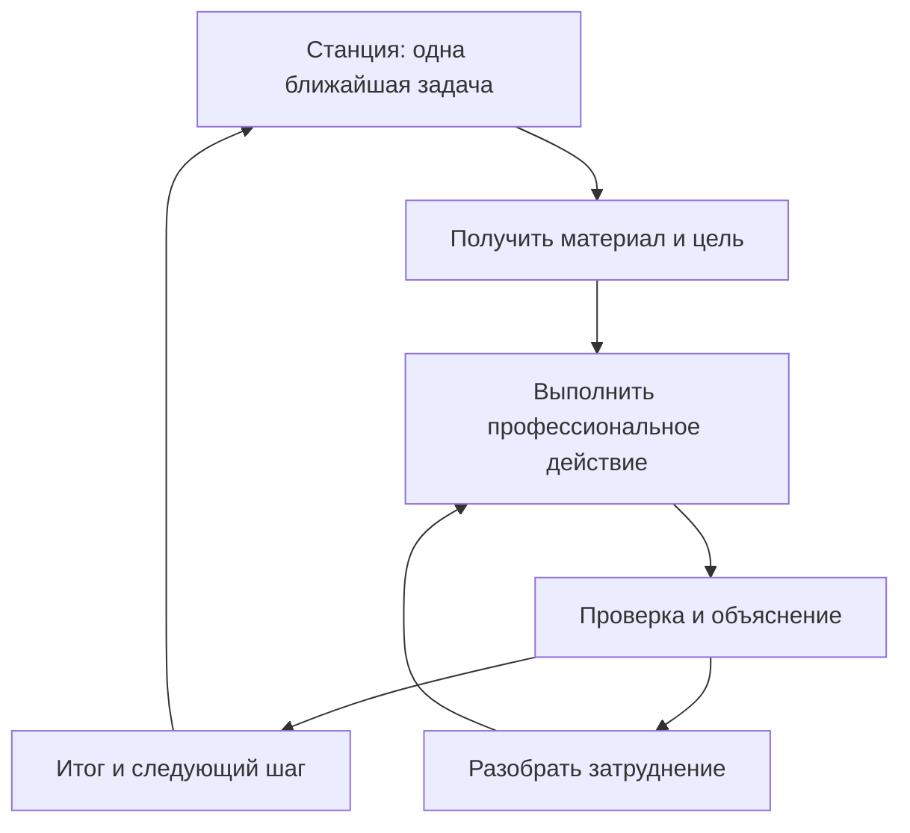

# 26063: Позывной «Синоптик» — первая сессия и жизнь станции

> Реализация следующего шага: [«Первый уровень и настройка персонажа»](PLAYABLE_LEVEL_ONE.md). В отдельный режим включены шесть повторно проверенных примеров температуры и точки росы, серверное сохранение и путь из гардероба. Ниже сохранён исходный проект: предложенный четырёхзадачный маршрут со схемой станции не выдаётся за реализованный вариант.

**Дата:** 21 ноября 2026 года.

**Задача:** `GAMEPLAY-ENTRY-01`. **Владелец сводного решения:** orchestrator, `/root`.

**Исследованная база:** `9ea0921`; локальная ветка работы — `agent/gameplay-entry/first-session`.

**Статус:** проект игрового опыта и план реализации; отдельно ниже описана небольшая выполненная правка входа. Короткая вводная смена, адаптивное повторение и новые предметные реакции этим документом не объявляются реализованными. Публикация и методический допуск учебного банка не выполнялись.

## 1. Решение

Основой игры должна стать **понятная рабочая смена с завершённым результатом**. Игрок приходит на станцию, получает посильную задачу, выполняет профессиональное действие, разбирается в результате и видит, что его работа сохранена. Следующая смена предлагает новый случай или возвращает к конкретному затруднению.

Интерес возникает из освоения работы: увидеть смысл в закодированной записи, собрать схему, заметить несогласованность, обосновать решение. Для этого нужны ясная ближайшая цель, постепенно возрастающая самостоятельность и видимый результат. Станция, свет, персонажи и звук поддерживают этот опыт; им нужны связи с действиями игрока.

Ближайшие приоритеты:

1. Упростить вход в уже существующее рабочее место и повторное открытие смены.
2. Спроектировать отдельную короткую первую сессию и провести методическую приёмку её содержания.
3. Связать подтверждённые ответы с небольшими реакциями предметов в действующем интерфейсе.
4. Сохранять разбор ошибок и предлагать один обоснованный следующий шаг.
5. Расширять случаи и сложность, затем развивать добровольную скоростную практику и другие режимы.

Критерий высокого качества здесь — цельность исполнения: одинаковая визуальная логика, предсказуемый ввод, убедительное окружение, полезная обратная связь, честное сохранение и отсутствие лишних препятствий. Число спрайтов само по себе этот критерий не определяет.

## 2. Проверенное состояние игры

Аудит выполнен по коду, данным и связям вызовов. Он не заменяет новое прохождение в браузере. Подробности и источники — в [аудите цикла](../testing/evidence/first-session/gameplay-core-review.md), [аудите входа](../testing/evidence/first-session/entry-flow-review.md) и [аудите атмосферы](../testing/evidence/first-session/atmosphere-gameplay-review.md).

| Область | Что подключено | Что требуется дальше |
|---|---|---|
| Обычная смена | Серверная смена, 10 заданий `core_ru_001@0.6.0`, проверка, объяснения, справка, некоторые повторы, восстановление незавершённой смены | Пакет остаётся `draft`; последовательность фиксирована; короткого вводного набора нет |
| Взаимодействия | Числовой ответ, выбор, схемы одной/нескольких станций, поиск ошибки, порядок действий | В первой сессии нагрузка растёт слишком быстро: до 16 размещений и графа зависимостей |
| Реальные награды | Серверные знаки «Первое дежурство», «Точный разбор», «Ритм станции» | Это ещё не полная система квалификаций и адресного обучения |
| Блиц | Отдельная практика: 90 секунд, 6 заданий; доступ после завершённой обычной смены; без наград, рейтинга и зачёта обычной смены | Сохранить добровольность и явный запуск таймера; не делать первым опытом новичка |
| Возвращение | Сохраняются попытки и агрегаты; активная смена восстанавливается сервером | Подробный разбор в оболочке смены живёт в памяти текущего посещения; адресный следующий шаг не замкнут |
| Расширенный учебный материал | Дополнительно подготовлены 30 шаблонов уровня 1 | Текущий `ShiftService` их не выбирает; заявленные 142 экземпляра не равны 142 доступным сейчас заданиям |
| Прогрессия | Есть отдельные определения и сервис C1–C5/mastery/экзамена | Рабочий `ShiftService` не передаёт туда подтверждённые результаты; клиентские записи закрыты с 409 |
| Соревнования | Есть проект PvP, Reliability, оперативного ресурса | Не активный игровой цикл; `/arena-tv` остаётся заглушкой |
| Станция | Основная кнопка смены уже выделена, библиотека доступна гостю, есть персонажи и часть природных эффектов | Закрытые помещения и второстепенные меню не должны конкурировать с ближайшей задачей |
| Персонализация | Сохранённый статичный портрет; гардероб необязателен | Сохранить принятое решение; личный персонаж не присутствует в мире |

Источники состояния: `apps/server/src/modules/shift/shiftService.ts`, `apps/web/src/features/shift/ShiftWorkspace.tsx`, `apps/server/src/modules/equipment/equipmentService.ts`, `apps/server/src/modules/progression/`, `content/packs/`, `content/tasks/`, `apps/web/src/features/hub/HubScreen.tsx`, `packages/world-engine/src/scenes/HubScene.ts`.

### Две границы, от которых зависит качество

**Учебная целостность.** Числа в нынешних заданиях на дешифрирование и в задании на станционный знак относятся к разным подготовленным примерам. Нельзя назвать их одной телеграммой, которую игрок последовательно переносит на карту. Для такого сценария нужен общий версионируемый снимок наблюдений и независимая методическая проверка всей цепочки.

**Подключённая функциональность.** Документ о живом мире, существующий аудиофайл или класс сцены не доказывают, что игрок сейчас видит соответствующее действие. Проверять нужно действующий маршрут. Например, часть предметных событий отправляется в старую Phaser-сцену, тогда как нынешнее рабочее место построено на React.

## 3. Основной игровой цикл

Стрелка от разбора к действию описывает целевой учебный цикл. В действующем режиме доступность повторной попытки ограничена серверными правилами и экипировкой; этот документ их не меняет.

### Масштаб одного действия

У каждого задания есть короткий ответ на три вопроса: что нужно сделать, с какими данными, какой результат ожидается. После проверки игрок видит содержательное объяснение и понятное следующее действие. Предметная реакция короткая, не закрывает ответ и не задерживает переход.

При ошибке показывать конкретное место расхождения, если валидатор его знает: отдельный компонент схемы, шаг или выбранный вариант. Не заменять объяснение общим «неверно» или эмоцией наставника. При верном решении отмечать освоенное действие; скорость не должна становиться скрытым главным показателем спокойной практики.

### Масштаб смены

У смены есть начало, конечный рабочий результат и короткий разбор. Будущий связный случай может последовательно использовать один утверждённый набор наблюдений для нескольких операций. Разные учебные примеры допустимы, но их следует честно обозначать как отдельные задания.

Каждый этап должен добавлять смысл. Возможный пример учебной композиции: расшифровка → представление на схеме → контроль → вывод в рамках утверждённого метода. Это не универсальный порядок профессионального анализа; конкретная последовательность требует методической приёмки. Нельзя наращивать количество полей ради длительности. На старте достаточно освоить одну операцию и применить её в немного другом представлении.

### Масштаб возвращения

Причина вернуться — понятный следующий навык, новый проверенный случай или возможность исправить конкретное затруднение. После устойчивого освоения одной станции увеличивать охват до трёх, затем до восьми. Следующее усложнение должно быть заметно игроку и основано на его подтверждённых результатах.

Сохранить удачное свойство текущей награды за три дня практики: дни не обязаны идти подряд. Не вводить наказание за пропуск, искусственные срочные события или обязательный ежедневный вход. Блиц может проверять знакомую операцию под временем после спокойного освоения.

## 4. Вход: авторизация и первые минуты

Это две разные задачи. Короткая форма входа не исправит непонятное первое задание; приятный урок не исправит потерянную сессию.

### Основной путь

| Состояние | Главное действие | Следующее состояние |
|---|---|---|
| Гость | «Начать смену» | Одна действующая форма входа по принятому списку → сразу рабочее место |
| Пользователь без активной смены | «Начать смену» | Получение задачи и первое действие |
| Пользователь с незавершённой сменой | В целевом интерфейсе «Продолжить смену» | Точное сохранённое состояние, краткий контекст текущего задания |
| Завершённая смена | Один следующий полезный шаг | Продолжение практики или выбранный разбор |

Разделение состояния для подписи «Продолжить» требует серверного чтения активной смены. Сейчас хаб всегда показывает «Начать смену», а сервер определяет восстановление при запуске. Не вызывать создающий POST из хаба только ради проверки подписи и не выводить сохранённый прогресс по догадке из локального состояния.

Уже работающие свойства нужно сохранить: станцию и библиотеку можно изучить до входа; выбор портрета не обязателен; после формы входа сохраняется намерение открыть смену. Не добавлять обязательные выбор режима, тур по зданиям, длинную биографию, гардероб или предварительный тест.

### Представление главного экрана

Центр внимания — станция и одна основная кнопка. Нынешний выделенный основной вход можно сохранить, а состояние и контекст сделать точнее.

- Первый визит: одна короткая цель, например «Познакомьтесь с работой станции». Длительность нового вводного режима показывать только после измерений.
- Продолжение: название или номер текущего этапа из серверного состояния. Небольшое «Вы остановились на…» должно помогать вспомнить задачу.
- Возврат после завершения: действительный результат последней смены и доступный следующий шаг. Не заполнять станцию выдуманной активностью других игроков.
- Открытые помещения дают ожидаемое действие. Закрытые здания могут оставаться частью мира, но не выглядеть равноценными рабочими пунктами обязательного маршрута.
- Библиотека и журнал остаются достижимыми; второстепенные сведения раскрываются по запросу.

Такое постепенное раскрытие позволяет держать ближайшие действия видимыми, сохраняя доступ к остальным возможностям. Это соответствует подходу [NN/g: Progressive Disclosure](https://www.nngroup.com/articles/progressive-disclosure/). Точная композиция требует проверки в самой игре.

### Авторизация и восстановление

Сохранить принятую модель учебных групп и запрет публичной самостоятельной регистрации. Не заменять подтверждение личности одним выбором имени для открытого Интернета.

Найденные отдельные задачи:

1. Заменить автоматический выбор первого человека в списке явным «Выберите своё имя». На общем компьютере удобство не должно приводить к работе в чужом профиле; предварительный выбор группы можно сохранить отдельно.
2. Согласовать экранную клавиатуру поля кода с серверным форматом: сейчас `inputMode="numeric"`, хотя допустимы также буквы. Не сужать действующий формат только на клиенте.
3. При сетевой ошибке начального `/me` дать явное повторение запроса и понятный статус.
4. При истёкшей сессии во время работы вернуть пользователя к входу с сохранением адреса назначения; неподтверждённый ответ не выдавать за сохранённый. Черновик не должен попасть к другому пользователю.
5. Ограничить ожидание запроса входа и дать повтор без потери безопасно сохраняемых полей.
6. Отдельно проверить `identityService.login`: ветка `!user.codeSet` не ограничена `securityProfile`. Это вопрос действующей модели доступа, а не основание ослабить её ради удобства. Нужны Security review и тесты соответствующих профилей перед открытым развёртыванием.

Эти изменения не входят в текущую небольшую правку интерфейса. Источники: `apps/web/src/features/identity/IdentityScreens.tsx`, `apps/web/src/App.tsx`, `apps/server/src/modules/identity/identityService.ts` и аудит входа.

## 5. Первая сессия: целевой ориентир 6–8 минут

**Это проект темпа, не таймер, не измеренное время и не уже готовый режим.** Человек может читать и разбираться дольше. Текущая обычная смена из десяти заданий сохраняется до отдельной реализации вводного набора.

| Ориентир | Действие | Что поддерживает интерес |
|---|---|---|
| 0:00–0:30 | Попасть к одной ясной задаче | Сразу понятны предмет работы и ближайшее действие; записка и наставник доступны по желанию |
| 0:30–1:40 | Прочитать одну группу и ввести значение | Короткая подтверждённая обратная связь, объяснение; первый видимый результат |
| 1:40–2:50 | Применить знакомое действие к следующему отдельному примеру | Проверка понимания, а не повторение ответа по памяти |
| 2:50–4:00 | Сделать один выбор и разобрать его основание | Небольшая смена взаимодействия; объяснение связано с конкретным решением |
| 4:00–6:10 | Выполнить четыре размещения на схеме одной станции | Получается законченный рабочий объект, а не только счётчик ответов |
| 6:10–8:00 | Посмотреть короткий итог и выбрать следующий шаг | Что удалось, одно затруднение при наличии, куда двигаться дальше |

Кандидаты существующих семейств: `kn01_temp_001`, `kn01_dewpoint_001`, `kn01_tendency_001`, `station_plot_basic_001`. Их нельзя автоматически объявлять методически принятым вводным курсом: основной пакет остаётся черновым. Возможна замена на утверждённые варианты после проверки совместимости.

На первом этапе эти четыре задачи честно остаются отдельными учебными примерами. Более сильная целевая версия использует один утверждённый случай, но потребует совместного источника наблюдений, согласованных payload и ответов. Нынешние числа нельзя соединять одним художественным текстом.

### Помощь и ошибки

Для вводного режима предлагается свободное учебное объяснение и возможность исправления, с отдельной отметкой самостоятельности. Потребуется серверная политика, отличная от нынешнего расхода справки/повторов. Нельзя незаметно переписать первую попытку или считать решение после полного объяснения самостоятельным.

Контекстная подсказка появляется у затруднения и может быть повторно открыта. Длинное предварительное обучение не нужно: человек должен попробовать действие. Такой подход поддерживают [NN/g: Contextual Help](https://www.nngroup.com/articles/onboarding-tutorials/) и [Xbox Accessibility Guideline 109](https://learn.microsoft.com/en-us/xbox/accessibility/xbox-accessibility-guidelines/109), где отдельно рассматриваются ясность цели и возможность повторного доступа к обучению.

### Завершение

Итог должен отвечать на три вопроса: что удалось, что разобрать, что доступно дальше. Например, можно предложить повтор конкретного семейства задач, только если серверный журнал действительно содержит соответствующее затруднение. При отсутствии ошибки не сочинять её ради одинаковой структуры экрана.

До реализации отдельно определить: засчитывается ли короткий вводный набор как завершённая обычная смена; какие награды допустимы; открывает ли он блиц. **По умолчанию не переносить** критерии десяти заданий на четыре. Новому режиму нужны собственные идентификатор, версия и правила завершения.

## 6. Что сделает атмосферу убедительнее

### Реакция на работу

Сейчас рабочее место вызывает `createCodePostBridge.triggerStamp/updateStreak`, но получатели находятся в старой `CodePostScene`. Текущий `/shift` использует React и `StationRoomArt`; сам факт отправки события не означает видимый штамп, кота или телетайп. Ближайшая работа — подключить небольшие реакции прямо к действующему представлению.

| Подтверждённое событие | Предлагаемая реакция | Ограничение |
|---|---|---|
| Сервер выдал задание | Появился рабочий бланк, короткий звук бумаги | Не блокировать ввод; не запускать повторно при безвредной перерисовке |
| Сервер проверил ответ | Штамп проверки/положение листа и содержательный текст результата | Ошибочный ответ тоже является проверенным; цвет и текст не должны обозначать ложный успех |
| Пользователь открыл разбор | Разворачивается тетрадь/выделяется нужный компонент | Не выдавать чтение за исправление ошибки или освоение навыка |
| Сервер подтвердил завершение | Бланки собраны, появляется итог и запись смены | Повтор ответа/обновление страницы не дублируют награду и событие |

Первый проход достаточно сделать без новых сложных анимаций. Для предотвращения повторного воспроизведения задавать ключ события через `shiftId`, `instanceId`, номер попытки и тип подтверждения. Сначала проверяется логика связи; потом добавляется оформление. Уменьшенная анимация должна сохранять смысл через статическое состояние.

### Звук

В аудиоманифесте уже есть 43 записи, в том числе предметные звуки. На маршрутах `/shift` и `/blitz` политика `study` сейчас останавливает и музыку, и комнатный фон. Часть подходящих предметных сигналов в действующем React-помещении не вызывается.

Поэтому первая задача — настроить использование имеющегося звука: бумага при получении/проверке, краткий предметный акцент, очень тихий фон комнаты в разрешённом пользователем режиме. Для сосредоточенной работы фон можно оставить выключенным; музыка, атмосфера и действия должны регулироваться раздельно. Стартовый звук остаётся выключенным, воспроизведение начинается после жеста пользователя, скрытая вкладка не звучит.

Ночной фон существует, но сейчас не выбирается по солнечной фазе. При его подключении нужно сохранить ночной дождь: существующий `playNightAmbient` удаляет дождевую дорожку, поэтому простая замена вызова будет неполной. Проверить согласованность света, внешнего фона и оконного света. Это задача интеграции существующих возможностей; новая генерация аудио пока не приоритет.

### Свет, глубина и окружение

Продолжить ранее начатый R08: общее направление света, контакт зданий с землёй, непрерывные дорожки, передний/средний/дальний планы, локальные перекрытия растениями и единый масштаб деталей. Контактные тени и переход основания здания в грунт особенно важны для устранения ощущения вклеенного объекта.

В помещении использовать направляющий свет к рабочему объекту и свободный от деталей участок под текст. Для оживления достаточно нескольких разнесённых по времени движений: пар, свет, редкий жест NPC, небольшая реакция предмета. Постоянное синхронное движение всего кадра ухудшит иерархию.

В существующей R01-ветке часть эффектов уже есть: свет, дождь, фонтан, NPC, синица и белка. Другие облака, сезонные сценарии и интерактивные животные из старых сцен не следует считать действующими без проверки пути вызова. Новая графика должна закрывать конкретную нехватку, установленную по кадру и событию.

### Люди и история

Использовать уже существующих Полину Синицыну и Иннокентия Борисовича Ольхина. Полина оставляет небольшие бытовые детали и контекст передачи смены; Ольхин помогает разобрать действие. Реплики короткие, уместные и необязательные. Общая похвала не должна заменять содержательную обратную связь.

Личный персонаж остаётся сохранённым статичным портретом согласно принятому решению. Ходьба героя по станции и новый контроллер движения для этого плана не нужны.

Декоративная погода станции не определяет правильность задания. Если сюжет смены описывает наблюдаемую погоду, описание выводится из согласованного снимка этого случая. Непроверенные фиксированные метеорологические утверждения в бытовой записке убраны текущей правкой.

## 7. План ресурсов и SpriteCook

Новые генерации в этой задаче не запускались. Предыдущие R08-ресурсы и их ограничения описаны в `assets/source/environment/hub/r08/PHASE2_REPORT.md`; пилот не считается принятым главным экраном.

| Приоритет | Ресурс | Сначала переиспользовать | Когда генерировать |
|---|---|---|---|
| P1 | Бланк: получен / проверен / собран | Фон рабочего места, существующие бумага и звук | Если после привязки событий не хватает отделяемого предмета с прозрачностью; 2–3 состояния из одной основы |
| P1 | Штамп или небольшой механический акцент | Имеющиеся предметные ресурсы и аудио | Если он нужен действующему React-помещению и отсутствует подходящий источник; без запечённого результата или научного текста |
| P1 | Тетрадь разбора: закрыта / открыта | Существующее оформление наставника/журнала | Только если существующего оформления недостаточно после привязки события; затем утвердить расположение и размеры, текст оставить живым интерфейсом |
| P2 | Несколько реакций существующего наставника | Принятый дизайн NPC | Только при потребности в конкретных состояниях, с одинаковыми пропорциями, палитрой и опорной точкой |
| P2 | Отдельные планы окна и света комнаты | Текущий `StationRoomArt`, световые маски | Если цельный фон мешает менять освещение без перекрашивания рабочего текста |
| P2 | Контакт земли, мягкие перекрытия растительностью | Уже созданные слои R08 | Только для выявленных зазоров, с проверкой масштаба и направления света |

Контракт каждого ресурса: роль в событии, логический размер и пиксельная сетка, прозрачность, опорная точка, направление света, маска перекрытия, состояния, безопасное поле для текста, источник и запись в манифесте. Отдельные здания не генерировать независимо от перспективы и освещения общей сцены.

КН-01, значения, станционные знаки, учебные схемы и объяснения остаются в проверяемых данных и SVG/Canvas/тексте. Художественная генерация не рисует правильный ответ. Сначала принимаются техническое качество пикселей и совместимость, затем композиция, затем подключение в сцене и браузерная проверка.

## 8. Что изменено в этой работе

Небольшое упрощение выполнено в четырёх файлах `apps/web/src/features/shift/`:

- `SeamlessShiftFlow.tsx`: удалён обязательный промежуточный экран приёма смены; переход на `/shift` сразу открывает одно рабочее место, где сервер начинает или восстанавливает смену.
- `ShiftWorkspace.tsx`: краткая подсказка первого действия; необязательная «Записка Полины» после карточки задания через закрытый по умолчанию `
`.
- `shiftLore.ts`: бытовой текст записки без несвязанных с текущей задачей утверждений о погоде.
- `ShiftWorkspace.css`: компактное оформление записки, состояния наведения, нажатия и клавиатурного фокуса.

Записка не управляет монтированием рабочего места, не содержит карточку ответа и не меняет его состояние. API, серверные правила, авторизация, десять заданий, проверка, награды и снимок экипировки не менялись. У блица остаётся отдельное явное начало: открытие его страницы не должно запускать таймер.

Существующие браузерные сценарии адаптируются под прямой вход: ожидания POST и имитация ошибки должны устанавливаться до перехода на `/shift`. Реальную браузерную приёмку в этой среде провести нельзя из-за ранее выявленного ограничения доступа к предпросмотру; статическая проверка не закрывает этот допуск.

## 9. Порядок реализации

| Этап | Результат | Владелец и зависимость | Условие готовности |
|---|---|---|---|
| P0: прямой вход | Убрано повторное принятие смены, записка доступна по запросу | UI; независимая интеграционная проверка | Сборка/инварианты и затем реальные клавиатура, касания, снимки |
| P0: устойчивое продолжение | Подпись по серверному состоянию, повтор сетевого запроса, восстановление после входа | Web + сервер; Security для сессий | Нет потери принятой попытки, нет переноса черновика между пользователями |
| P1: вводная смена | Отдельный короткий набор с ясной целью | Проектировщик игрового процесса + методолог + независимый верификатор | Принятые содержание, помощь, завершение и награды; серверная проверка |
| P1: рабочее место реагирует | Два-три предметных состояния по подтверждённым событиям | UI + world/audio; Art Director | Нет ложного успеха, дубликатов, блокировки ввода; режим уменьшенной анимации |
| P1: полезное возвращение | Долговечный разбор и один следующий шаг | Сервер + учебный материал + UI | Рекомендация объясняется сохранённой попыткой; прогресс не поступает от клиентского `isCorrect` |
| P2: разнообразие | Проверенные варианты и постепенное расширение 1 → 3 → 8 станций | Учебный материал + сервер + методический контроль | Новые случаи, воспроизводимые версии и источники, измеренный темп |
| P2: цельная атмосфера | Принятые R08-композиция, свет, переходы грунта и звуковые профили | Арт/интеграция/производительность | Просмотр в действующей сцене, единый стиль, плавность на целевых устройствах |

PvP, рейтинг и большая новая экономика идут после проверки основной петли. Их правила, защита результатов и польза для аудитории требуют отдельного решения.

## 10. Приёмка и измерение

### Сценарии, обязательные до публикации правки входа

1. Гость нажимает основное действие, проходит действующий вход и попадает к заданию; обязательного гардероба или записки нет.
2. Пользователь с активной сменой получает прежние `shiftId`, `instanceId`, прогресс и снимок экипировки. Посещение гардероба не переписывает снимок уже начатой смены.
3. Введённое значение сохраняется при открытии/закрытии записки. Не возникает новый POST `/api/shifts`; не меняется экземпляр задачи. Проверить мышью, касанием и клавиатурой.
4. Справка, решение о повторе, проверка ответа, переход и итог сохраняют прежние серверные правила. Сетевая ошибка отличается от неверного ответа.
5. Размеры 1366×768, 390×844, 844×390: основной ввод доступен, заметен фокус, нет перекрытия задания запиской; отдельно проверены прокрутка и длинные подписи.
6. Без звука и при уменьшенной анимации сохраняется полный смысл. В блице таймер всё ещё запускается явным действием.

### Проверка будущей первой сессии

Наблюдать несколько первых прохождений, например 5–7 человек разной подготовки. Такая небольшая группа выявляет затруднения, но не является статистическим доказательством роста удержания.

Проектные ориентиры: ближайшее действие понятно без устного сопровождения; первый осмысленный ввод — примерно в течение 30–60 секунд после действительного входа; первая завершённая петля занимает около 6–8 минут без принудительного ограничения. Эти числа нужно проверить, а не выводить как фактические достижения.

Измерять этапы: открытие станции → намерение начать → вход завершён → задача загружена → первый ответ → первая обратная связь → завершение → выбран следующий шаг. Отдельно учитывать сетевые ошибки, возврат в активную смену, использование помощи и остановку на конкретном семействе заданий. События не должны содержать секреты входа; идентификаторы и хранение проектируются вместе с правилами доступа.

Полезные качественные вопросы: «Что вы сейчас делаете?», «Почему ответ оказался таким?», «Что будете делать дальше?». Если игрок уверенно нажимает кнопки, но не понимает работу, одной визуальной полировки недостаточно.

## 11. Доказательства и ограничения

- [Аудит игрового цикла](../testing/evidence/first-session/gameplay-core-review.md).
- [Аудит входа и границ текущей правки](../testing/evidence/first-session/entry-flow-review.md).
- [Аудит атмосферы и связи с действиями](../testing/evidence/first-session/atmosphere-gameplay-review.md).
- [Независимая интеграционная проверка](../testing/evidence/first-session/independent-review.md).
- [Результаты проверок](../testing/evidence/first-session/validation.json).

Статические проверки и сборка подтверждают ограниченный технический объём. Они не доказывают удобство на телефоне, сохранение реального DOM-ввода при взаимодействии, восприятие темпа или готовность уровня дорогой коммерческой игры. Эти пункты остаются предметом живой приёмки и наблюдения за игроками.

План не меняет профессиональную методику. Любые новые связанные наблюдения, ответы, символы, объяснения или порядок содержательных операций требуют принятого профиля метода, исходных источников и независимой проверки в соответствии с `AGENTS.md`.

## 12. Дополнительные источники проектирования

- [Microsoft XAG 109 — Objective clarity](https://learn.microsoft.com/en-us/xbox/accessibility/xbox-accessibility-guidelines/109): доступность цели, контекст продолжения, обучение и возможность вернуться к нему.
- [Microsoft XAG 114 — UI context](https://learn.microsoft.com/en-us/xbox/accessibility/xbox-accessibility-guidelines/114): назначение управляющего элемента, ожидаемый результат, подписи и контекст.
- [NN/g — Progressive Disclosure](https://www.nngroup.com/articles/progressive-disclosure/): первичные и дополнительные действия.
- [NN/g — Memory Recognition and Recall in User Interfaces](https://www.nngroup.com/articles/recognition-and-recall/): видимый контекст и помощь рядом с действием.
- [NN/g — Onboarding Tutorials vs. Contextual Help](https://www.nngroup.com/articles/onboarding-tutorials/): доступная по запросу контекстная помощь.

Это источники общих принципов интерфейса. Конкретная длительность, состав учебной смены и визуальный результат — проектные предложения для этой игры, требующие собственной проверки.
