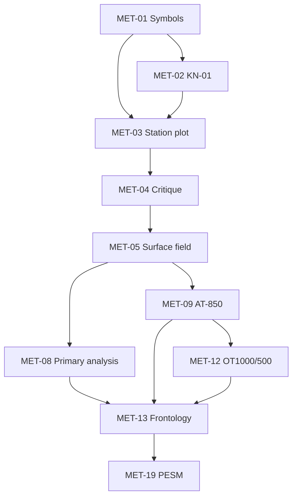

# Учебные модули синоптической метеорологии

**Статус:** proposed

Цель файла — разложить предметную область на независимые модули, которые можно подключать к курсу и content pack отдельно.

| ID | Модуль | Базовые навыки | Типы задач | Уровень |
|---|---|---|---|---|
| MET-01 | Условные обозначения | ww, облачность, ветер, знаки | choice/classify | базовый |
| MET-02 | КН-01 | decode/encode, группы, контроль | decode/encode/findError | базовый |
| MET-03 | Схема станции | нанесение вокруг кружка | stationPlot/dragDrop | базовый |
| MET-04 | Критика наблюдений | логическая и пространственная проверка | findError/compare | базовый-средний |
| MET-05 | Приземное барическое поле | В/Н, изобары, ложбины, гребни | hotspot/drawLine | средний |
| MET-06 | Изаллобарическое поле | П/Р, изотенденции | drawLine/classify | средний |
| MET-07 | Подъём карты | осадки, туманы, явления | hotspot/paint | средний |
| MET-08 | Первичный анализ | последовательность обработки | sequence/scenario | средний |
| MET-09 | АТ-850 | высоты, T, фронтальные признаки | compare/hotspot | средний |
| MET-10 | АТ-700/500 | ведущий поток, ложбины/гребни | compare/scenario | средний-продвинутый |
| MET-11 | АТ-300 | струйное течение | hotspot/drawLine | продвинутый |
| MET-12 | ОТ1000/500 | тепло/холод, термическое поле | classify/compare | средний |
| MET-13 | Фронтология | история, вертикальное согласование, комплекс признаков | scenario/drawLine | продвинутый |
| MET-14 | ВФЗ | трёхмерный анализ | compare/scenario | продвинутый |
| MET-15 | Аэрологическая диаграмма | стратификация, Td, слои | draw/compare | продвинутый |
| MET-16 | Вертикальный разрез | пространственная структура атмосферы | compare/hotspot | продвинутый |
| MET-17 | МРЛ | радиоэхо, конвекция, опасные зоны | classify/hotspot | спецкурс |
| MET-18 | Спутниковый анализ | облачные системы, вихри, нефанализ | classify/compare | спецкурс |
| MET-19 | ПЭСМ | перемещение, эволюция, суточный ход, местные факторы | scenario | продвинутый |
| MET-20 | ОЯ | опасные явления и штормовая информация | scenario | спецкурс |
| MET-21 | Авиационная метеорология | METAR/TAF, ТЯН, обледенение, струйные течения | decode/scenario | спецкурс |
| MET-22 | Региональная синоптика | особенности территории | scenario | продвинутый |

## Зависимости модулей

## Требования к каждому модулю

У модуля должны быть:

- `module_id`;
- learning outcomes;
- prerequisites;
- terms/notation;
- method profile requirements;
- supported task types;
- минимальный набор примеров;
- набор ошибок/reason codes;
- источники;
- критерии mastery;
- критерии допуска к следующему модулю.

## Правило расширения

Новый предметный блок не добавляется напрямую в UI. Сначала создаётся запись модуля, затем skills/tasks/scenarios, и только после этого — экран/режим.
