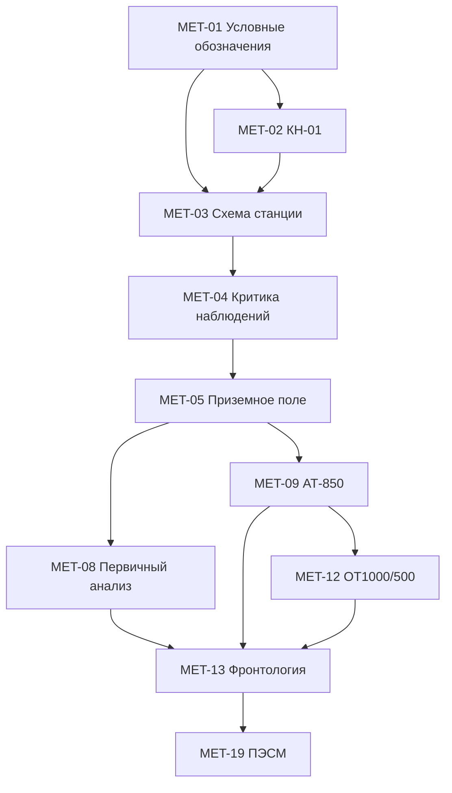

# Учебные модули синоптической метеорологии

**Статус:** предложено

Цель документа — разложить предметную область на независимые модули, которые можно по отдельности включать в курс и пакеты учебного содержания.

| Код | Модуль | Базовые навыки | Технические типы заданий | Уровень |
|---|---|---|---|---|
| MET-01 | Условные обозначения | `ww`, облачность, ветер, знаки | `choice`, `classify` | базовый |
| MET-02 | КН-01 | дешифрирование, кодирование, группы, контроль | `decode`, `encode`, `findError` | базовый |
| MET-03 | Схема станции | нанесение вокруг кружка | `stationPlot`, `dragDrop` | базовый |
| MET-04 | Критика наблюдений | логическая и пространственная проверка | `findError`, `compare` | базовый–средний |
| MET-05 | Приземное барическое поле | В/Н, изобары, ложбины, гребни | `hotspot`, `drawLine` | средний |
| MET-06 | Изаллобарическое поле | П/Р, изотенденции | `drawLine`, `classify` | средний |
| MET-07 | Подъём карты | осадки, туманы, явления | `hotspot`, `paint` | средний |
| MET-08 | Первичный анализ | последовательность обработки | `sequence`, `scenario` | средний |
| MET-09 | АТ-850 | высоты, температура, фронтальные признаки | `compare`, `hotspot` | средний |
| MET-10 | АТ-700/500 | ведущий поток, ложбины, гребни | `compare`, `scenario` | средний–продвинутый |
| MET-11 | АТ-300 | струйное течение | `hotspot`, `drawLine` | продвинутый |
| MET-12 | ОТ1000/500 | тепло, холод, термическое поле | `classify`, `compare` | средний |
| MET-13 | Фронтология | история, вертикальное согласование, комплекс признаков | `scenario`, `drawLine` | продвинутый |
| MET-14 | ВФЗ | трёхмерный анализ | `compare`, `scenario` | продвинутый |
| MET-15 | Аэрологическая диаграмма | стратификация, Td, слои | `draw`, `compare` | продвинутый |
| MET-16 | Вертикальный разрез | пространственная структура атмосферы | `compare`, `hotspot` | продвинутый |
| MET-17 | МРЛ | радиоэхо, конвекция, опасные зоны | `classify`, `hotspot` | специальный курс |
| MET-18 | Спутниковый анализ | облачные системы, вихри, нефанализ | `classify`, `compare` | специальный курс |
| MET-19 | ПЭСМ | перемещение, эволюция, суточный ход, местные факторы | `scenario` | продвинутый |
| MET-20 | Опасные явления | опасные явления и штормовая информация | `scenario` | специальный курс |
| MET-21 | Авиационная метеорология | METAR/TAF, ТЯН, обледенение, струйные течения | `decode`, `scenario` | специальный курс |
| MET-22 | Региональная синоптика | особенности территории | `scenario` | продвинутый |

Названия типов заданий остаются на английском только как программные идентификаторы схемы данных.

## Зависимости модулей

## Требования к каждому модулю

У модуля должны быть определены:

- `module_id` — технический идентификатор;
- учебные результаты;
- предварительные требования;
- термины и обозначения;
- требования к методическому профилю;
- поддерживаемые типы заданий;
- минимальный набор примеров;
- типичные ошибки и их машинные коды;
- источники;
- критерии освоения;
- критерии допуска к следующему модулю.

## Правило расширения

Новый предметный блок не добавляется напрямую в пользовательский интерфейс. Сначала создаётся запись учебного модуля, затем компетенции, задания и сценарии, и только после этого — отдельный экран или режим.
