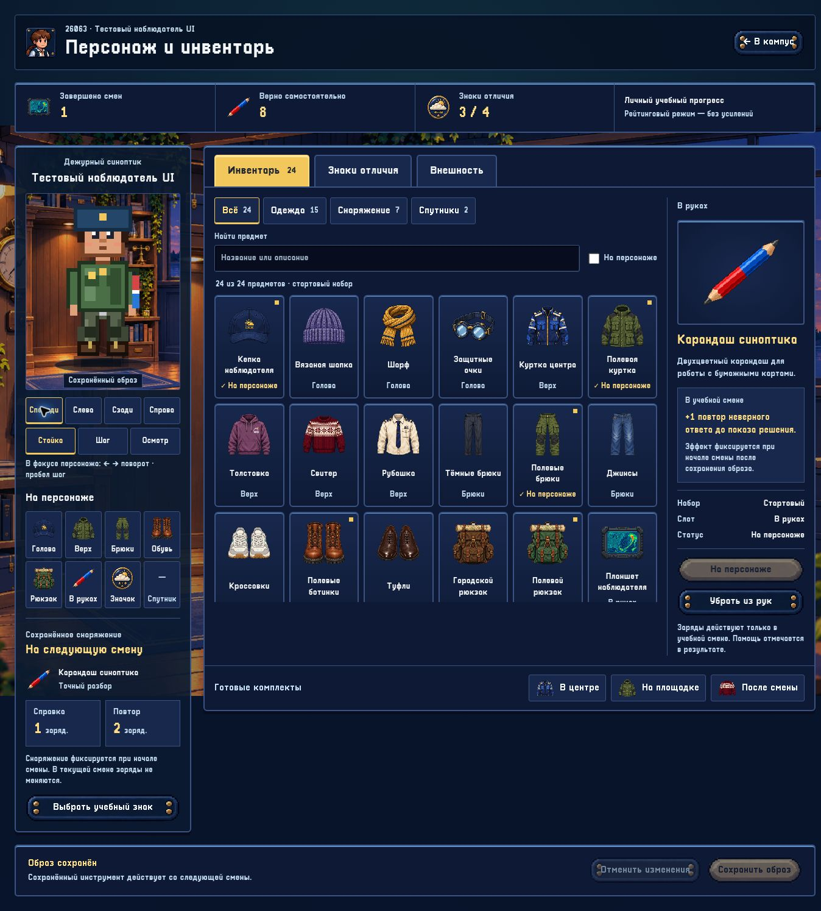
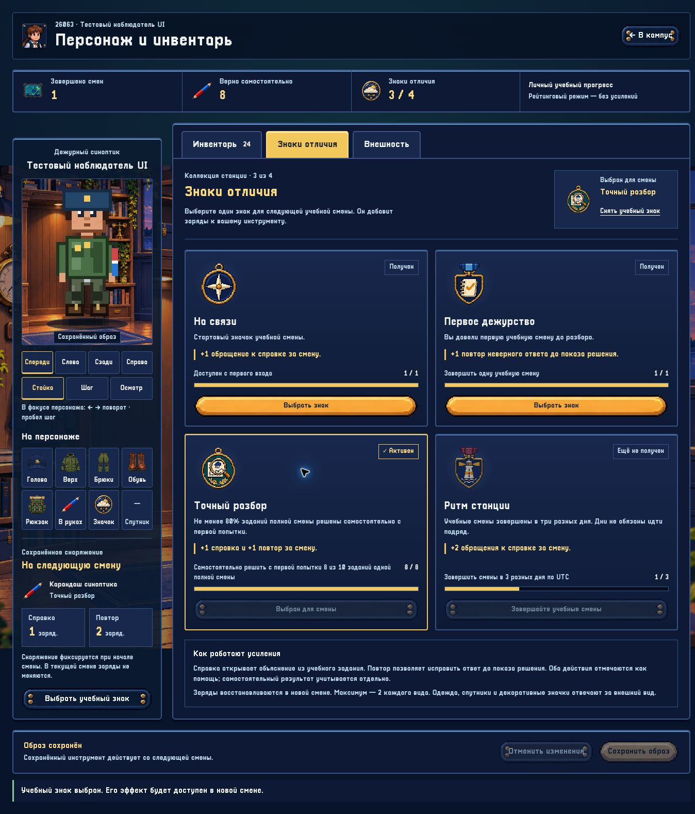

# Восстановленная интеграция: инвентарь, знаки и учебные усиления

Дата: 10.11.2026. Координатор: `/root`.
Задача: `RECOVERY-INVENTORY-20261110`.

Это актуальная передача состояния после восстановления предыдущей работы
и дополнительных исправлений. Более ранние отчёты сохранены как история
их проверок; их ограничения читаются вместе с этим документом.
Сводка относится к локальной приёмке кандидата. Удалённый CI, его точный
head SHA и результат слияния фиксируются в интеграционном PR; локальные
проверки не заменяют Linux/Astra-проверки GitHub Actions.

Версия кандидата — **0.3.0**. Существующий тег `v0.2.0` оставлен неизменным;
новая версия позволяет штатному сценарию после слияния создать отдельный
Linux-архив и SHA-256. Версия конфигурационной схемы остаётся 2, встроенный
Node — 22.23.4; фактические commit и контрольные суммы записывает
`scripts/release/write-manifest.py` в манифест конечного пакета.

## Сохранность работы и история

Исходная основа `main` — `81829ca58772108e929f65433cb48d7fbe20b3b5`.
Восстановлены все **340 путей** из сохранённого экспорта интеграции
`d9d780d9b21207e5e1bee54464c44895d4f92fb2`. Старый worktree сохранил файлы,
но его `.git` указывал на отсутствующий родительский каталог.

Дерево до дополнительных исправлений точно совпало с экспортом:
`249198299e8f0a5ef5ec5c22b3485511c6f5b8cd`.
Все **283 уникальных Git blobs** переданы в GitHub и проверены по SHA;
сервер GitHub создал дерево с тем же идентификатором. Удалённый коммит
восстановления — `8ac68bccb313e1700cbcf710923742d848b4aed2`.
Локальный коммит того же дерева — `594e766ff2cd001cf85b728aa077184054380e09`;
это разные commit metadata, а не разные исходники.

Независимый отчёт:
[2026-11-10-recovery-review.md](2026-11-10-recovery-review.md).
Он подтверждает сохранность **218/218** проверенных художественных файлов
и прежних приёмок, всех шести найденных исходных генераций и **59/59**
записей [реестра SpriteCook](../../assets/manifests/spritecook-assets.json).

Ветка `feature/equipment-badges-buffs-20261110` сохранена. Её альтернативная
серверная схема не смешивается с текущей: отличия правил наград и
несовместимый формат старых сохранений описаны в независимом отчёте.
Экспериментальные H3D-ветки и черновые PR не объявляются принятым релизом.

## Рабочий игровой цикл

1. Игрок открывает «Персонаж и инвентарь» из кампуса, выбирает одежду,
   инструмент и декоративные элементы. Каталог содержит 24 предмета,
   29 изображений и три комплекта; внешний вид — 11 полей и 42 значения.
2. Примерка становится профилем только после успешного серверного
   сохранения. Поиск, категории, фильтр надетых вещей, восемь слотов,
   внешний вид, четыре ракурса и действия доступны на одном экране.
3. Во вкладке «Знаки отличия» выбирается один полученный учебный знак.
   Этот слот отделён от декоративного значка внешности.
4. При начале смены сервер фиксирует инструмент, учебный знак и лимиты.
   Изменение комплекта позже действует со следующей смены; повторный вход
   возвращает текущую смену и её оставшиеся заряды.
5. Справка открывает авторское объяснение с источниками. После первого
   неверного ответа можно потратить заряд на явную вторую попытку до
   показа решения. Помощь отмечается отдельно, первая ошибка сохраняется.
6. Завершённая смена, статистика и новые знаки записываются одной
   транзакцией. Повтор запроса и конкурентные запросы не выдают награды
   и не расходуют заряды второй раз.

| Учебный знак | Условие | Эффект на смену |
|---|---|---|
| На связи | Доступен с первого входа | +1 справка |
| Первое дежурство | Одна полная завершённая смена | +1 повтор |
| Точный разбор | Не менее 80% первых ответов одной полной смены самостоятельно: 8 из 10 | +1 справка, +1 повтор |
| Ритм станции | Полные смены в три разных дня UTC, подряд не обязательно | +2 справки |

Планшет и папка добавляют по одной справке; карандаш — один повтор.
Суммарный предел — **два заряда каждого вида**. Эффекты разрешены только
в `practice` и `practice-draft`. Рейтинговый и экзаменационный результат
не усиливается. Учебный пакет по-прежнему проходит методическую приёмку.
Подробный контракт: [EQUIPMENT_AND_BUFFS.md](../gameplay/EQUIPMENT_AND_BUFFS.md).

## Что исправлено после восстановления

- **Надёжное сохранение профиля.** Новый образ становится видимым в памяти
  только после успешной записи. Ошибка атомарного переименования не меняет
  действующий комплект и не блокирует последующие записи. Добавлены две
  проверки реального отказа файловой операции и конкурентных сохранений.
- **Сохранность примерки.** Черновик хранится отдельно для аккаунта в
  `sessionStorage`. После Back/Forward или повторного открытия предлагается
  восстановление либо удаление. Неизменённые поля свежего серверного
  образа сохраняются; конфликт изменения поясняется. Повреждённый черновик
  не попадает в профиль. Это временная примерка одной вкладки, не серверное
  хранилище предметов или наград.
- **Анимация и слои.** Осмотр завершает все четыре кадра, включая экономный
  режим. При уменьшенном движении показана неподвижная поза с пояснением.
  Задний слой рюкзака больше не перекрывается туловищем.
- **Честный разбор.** `firstAttemptCorrect` проходит через веб-контракт.
  Верный повтор сохраняет первую ошибку в журнале; наставник объясняет это.

Изменения независимо прочитаны `/root/recover_audit`; хеши проверенных
исходников сохранены в его evidence. Координатор отдельно воспроизвёл
серверные и браузерные сценарии.

## Проверки кандидата

| Область | Фактический результат |
|---|---|
| Свежая компиляция и серверные тесты | 48/48 PASS |
| Web TypeScript и production build | PASS после последних UI-изменений |
| Реальный HTTP API экипировки | PASS: полная смена, 11 уникальных попыток, рестарты, конкуренция, изоляция аккаунтов |
| Каталог и HTTP API внешности | PASS: все 42 значения, сохранение, рестарт, отказ для неизвестных ID и анонимного запроса |
| Дополнительные обязательные локальные проверки | 26/26 PASS; codec 16/16, content-engine 16/16, world tests и Python-контракты |
| R01 и художественные контракты | Четыре конвейера `--check`, 44 манифеста, 59 хешей SpriteCook — PASS |
| Свежая браузерная регрессия | Восстановление/удаление примерки, сохранение, задний рюкзак, выбор знака, reduced motion, успешный повтор с первой ошибкой — PASS |

Сводка координатора:
[coordinator-checks.json](evidence/recovery-20261110/coordinator-checks.json).
HTTP evidence:
[equipment-api.json](evidence/recovery-20261110/equipment-api.json).
Дополнительный локальный CI с полными логами:
[local-ci/report.json](evidence/recovery-20261110/local-ci/report.json).
Наблюдения браузера:
[browser-regression.json](evidence/recovery-20261110/browser-regression.json).

### Условия браузерной проверки

Проверена свежая production-сборка веба на 1363×936 CSS px в CUA Chrome.
Она подключена к ранее поднятому изолированному backend-харнессу
восстановленной версии. Новый identity persistence fix проверен отдельно
на свежескомпилированном сервере; браузерный backend этим прогоном не
объявляется пересобранным. Использован только тестовый профиль.

После правильного повтора задания 5 наблюдались `Повтор 2/2 → 1/2`,
«Верно после повтора», счётчик первой ошибки `1` и сводка `5 ответов,
4 верно с первой попытки, 1 с помощью`. После досрочного выхода текущая
смена осталась доступна для продолжения.

## Графика и расходы SpriteCook

Повторно использованы принятые прозрачные персонажи, NPC-анимации,
четыре учебных значка, короткая анимация награды, кабинет, иконки вещей,
интерфейсные детали и слои кампуса. Все исходники и производные остаются
в репозитории, ID сервисных ресурсов — в реестре. В этой восстановительной
итерации **новые генерации не запускались и кредиты SpriteCook не
расходовались**. Проверено наличие ранее завершённого UI-kit и отсутствие
незавершённых заданий сервиса.

## Точная граница готовности и следующий этап

Личная примерка остаётся процедурным Canvas 32×48. Три детальных
SpriteCook-персонажа — NPC кампуса; они не заменяют все сочетания одежды
игрока. Следующий художественный этап — собственные согласованные слои
игрока, четыре направления и анимации экипированных комплектов с
дальнейшей связью с перемещением в кампусе. Перед генерацией следует
использовать существующие исходники и реестр, а не создавать их заново.

Свежий браузерный прогон не подтверждает физический телефон, проектор,
FPS/GPU или низкую мощность устройства. Ранее принятые адаптивные проверки
сохранены в исторических отчётах. Существующее предупреждение Vite о
крупном JS-чанке не устранено этой интеграцией.

`tools/validate_pixel_art.py` отсутствует; успешный запуск ему не приписан.
Применены существующие конвейеры и независимая проверка PNG. Три старых
предупреждения о кандидатных файлах вне R01 также сохранены в отчёте.
Локальная среда использовала Node 24.22.1; обязательный CI закрепляет
Node 22.23.4, сборку Linux-архива и проверку Astra Linux 1.7.
