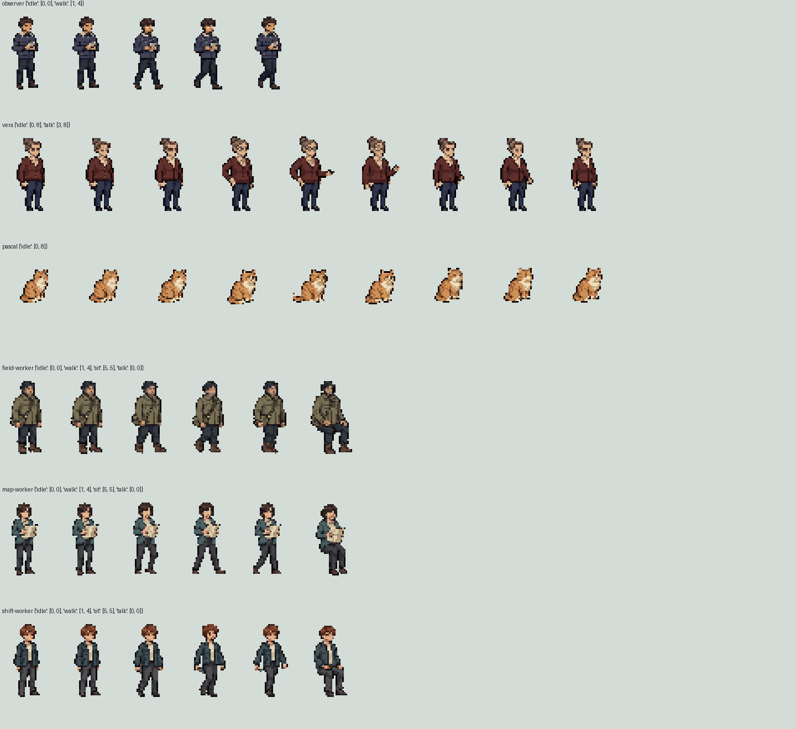

# Завершение персонажей R02 и рабочих комнат

Дата: 16 ноября 2026 года. Задача `STATION-R02-COMPLETION`.

Статус: реализация завершена. Полный CI и независимая художественная, интерфейсная и интеграционная приёмка версии `66ca23f` — PASS. Интеграция оформлена в [PR №132](https://github.com/f2re/synopsis_game/pull/132); [независимый итоговый протокол](2026-11-16-station-r02-integration-review.md) определяет область допуска и ограничения.

В результат входят восстановленные персонажи R02 и их редактируемые исходники, две дополнительно созданные серии Веры Павловны и Паскаля, подключённые рабочие комнаты, исправленное размещение персонажей и проверенное управление диаграммой. Изменения записаны в разделе `Unreleased` журнала проекта; версия пакета остаётся 0.5.3.

## На чём остановилась предыдущая работа

При начале восстановления основная ветка указывала на [`a381888c`](https://github.com/f2re/synopsis_game/commit/a381888c034f12ec17a27b501952989b114253d1), 14 ноября. PR №129, №130 и №131 уже объединены; библиотека выпущена в версии 0.5.3. Изменения персонажей и комнат от 15 ноября отсутствовали в удалённых ветках, но исходные ресурсы сохранились в SpriteCook.

У исходной основной ветки не были завершены [сборочные проверки](https://github.com/f2re/synopsis_game/actions/runs/43596981824) и [четыре браузерных задания](https://github.com/f2re/synopsis_game/actions/runs/43596981800). Причины установлены по журналам и воспроизведены на уровне исходников:

- сравнение сжатых PNG зависело от версии zlib, хотя пиксели совпадали;
- сценарий примерочной ожидал предмет во вкладке «Внешность», не открыв «Инвентарь»;
- проверка входов при изменении размера приравнивала размер буфера к CSS-размеру и не учитывала плотность 2×;
- проверочная заготовка примерки не содержала координат опоры, добавленных в компонент ранее.

После устранения ошибки PNG полный CI дошёл до ранее скрытого дефекта: импорт `station-fauna.json` в модульном компоновщике не содержал обязательный для нативного Node 22 атрибут `type: 'json'`. Эта строка уже присутствовала в исходном `main`. Исправление относится к загрузке модуля; графические исходники и правила композиции не меняются.

Следующий ранее недостигнутый сценарий инвентаря ожидал плоские имена `*_reviewed.png`, хотя основная ветка уже использовала зарегистрированные семантические имена `wardrobe/headwear.cap.png`. Проверка приведена к действующему манифесту: локальный канонический путь, один параметр версии `v`, контрольная сумма исходника, сигнатура PNG и точный размер 64×64. Все 42 значения проверены через настоящий API, включая перезапуск и раздельные учётные записи.

## Что восстановлено и дополнено

### Персонажи

Сохранены существующие идентификаторы внешности и снаряжения, четыре ракурса и геометрия модульного персонажа. Восстановлены согласованные исходники R02, походки наблюдателя и трёх сотрудников, сидячие позы, синица, белка и их миниатюры. Новый материал проходит путь «исходник SpriteCook → редактируемый Aseprite → манифест → воспроизводимая сборка».

Для Веры Павловны и Паскаля дополнительно созданы два листа по девять поз. Идентификаторы: `eba57b9c-072c-445c-8063-764689be22cc` и `c6867f7d-9525-4c7e-bf00-fc26f9df9585`. Стоимость — 24 кредита, остаток после генерации — 2 кредита. У листа Веры обнаружено обрезание нижней части фигуры; оно присутствовало и в сохранённом исходнике прозрачности. Новые жесты скомпонованы с полными ногами принятой фигуры. Общая опора и взрослые пропорции сохранены; повторная платная генерация не потребовалась.

PNG персонажей получили каноническое кодирование. Проверка совпадения байтов выполнена на zlib 1.3.1 и 1.3.2. Походки используют собственные кадры; интерполяция растровых кадров не добавлена. Направления синицы сверены с существующим отражением спрайта в сцене.

Это контактный лист исходных кадров, а не снимок работающей сцены.

Сохранённые пользовательские портреты продолжают действовать как данные профиля. После обновления графики примерочная предлагает «Обновить портрет»; повторно выбирать одежду не требуется. Начатая смена сохраняет портрет и снаряжение, зафиксированные при её старте.

Браузерный обзор выявил, что прежняя логика скрывала наблюдателя при наличии остальных сотрудников. Он подключён к сцене; для прохода перед фонтаном задан ограниченный маршрут с разворотом, постоянной опорой и отдельными границами двух ориентаций. Прежний предел трёх анимируемых постоянных персонажей сохранён: наблюдатель, Вера и Паскаль. Уменьшенное движение возвращает наблюдателя в спокойную исходную позу. Семь нативных тестов и проверка полного производственного набора подтверждают границы, разворот, отражение, смену ориентации, сокращение посетителей и освобождение ресурсов. Все 204 проверенных PNG персонажей и животных остались побайтно прежними после этого изменения размещения.

Обзор новой сцены также выявил, что прежняя настольная позиция Паскаля находилась за фонтаном. Кот перенесён вправо от него, с `[453, 469]` на `[548, 471]`; портретная позиция сохранена. По независимой модели альфа-каналов и глубин все девять кадров теперь открыты статическим декором. Дополнительно проверены 10 912 сочетаний положения и кадра для 16 экземпляров в двух ориентациях: полностью скрытых фигур в этой выборке нет. [Авторский расчёт](evidence/station-r02/station-r02-all-actors-occlusion.json), [независимый пересчёт](evidence/station-r02/independent-occlusion-check.json) и [неизменность PNG](evidence/station-r02/pascal-placement-png-comparison.json) сохранены. Это модель геометрии и прозрачности; фактический кадр и перекрытие интерфейсом принимаются отдельно в браузере.

### Рабочие комнаты

| Экран или действие | Помещение |
|---|---|
| Приём смены, числовые и кодовые задания | Телеграфная |
| Нанесение станции, планшет наблюдений, поиск ошибки, последовательность анализа | Синоптическая комната |
| Завершение смены и блица | Читальня |
| Блиц | Комната по текущему типу задания |

Два восстановленных исходника: `d6e112a3-024d-4a6b-9d21-a76de48552bc` и `e1466f8b-85a0-4b49-a8de-40982572accc`. Каждый разделён на вид за окном, передний интерьер и маску стекла. Проверка обнаружила пересечение дождя с радиоприёмником; маска исправлена и повторно принята независимо. Шесть PNG занимают 460 126 байт, расчётный объём декодированных изображений — 3 538 944 байта.

Рабочие окна оставляют помещение видимым, инструкция раскрывается отдельным действием. Научная геометрия SVG/Canvas, единицы, эталоны ответов и учебные источники не изменены. Уменьшенная анимация, экономичный режим и скрытая вкладка используют существующий общий контур атмосферы.

В Firefox обнаружено воспроизводимое расхождение на нижнем краю позиции станционной модели при дробной прокрутке: точка находилась внутри объявленной формы, но `elementFromPoint` возвращал корневой SVG вместо элемента управления. Перенос заливки на интерактивную форму и ожидание после перемещения мыши не устранили расхождение. Исторический тест останавливался на этом утверждении **до отправки клика**, поэтому его отрицательные результаты сами по себе не доказывают отказ реального события мыши. Координаты данных, текст, ветер, размеры целей и все девять точек с отступом 0,5 CSS px сохраняются; новый прогон отдельно проверяет фактическое событие и изменение ответа.

Выравнивание внешнего SVG по целым CSS-пикселям также не устранило расхождение. [Отрицательная проверка этой версии](evidence/station-r02/diagnostic-4e54e20-firefox/failure-case.json) сохраняет фактическую границу попадания и результаты временных диагностических вариантов. Проверка не подтверждает конкретный номер ошибки движка Firefox. Неэффективная компенсация положения удалена.

Исправление обрабатывает щелчок, который браузер адресовал самому SVG: координата преобразуется в систему существующей фигуры, и действие разрешается только при попадании ровно в одну область выбора. Научная геометрия и области управления сохраняются. Проверка каждого из девяти краевых нажатий дополняется фактическим снятием и повторным назначением наблюдения; отдельно сохраняется первоначальное заполненное состояние и проверяется реальная замена значения на проблемном нижнем краю.

[Первый журнал реального клика](evidence/station-r02/diagnostic-a9adfd6-firefox/failure-case.json) показал отдельную особенность ввода Firefox: запрос `x=839,900024` пришёл как `clientX=839`, левее границы фигуры `839,400024`. Обработчик правильно отказался менять ответ за пределами области. Браузерный сценарий поэтому сохраняет номинальные точки с отступом 0,5 CSS px, но отправляет ближайшие целые CSS-координаты. Округление ограничено 0,5 px по каждой оси; обе точки должны находиться внутри той же единственной фигуры. Запрошенная номинальная точка, отправленная координата и полученное доверенное событие записываются отдельно, а успех требует фактического изменения ответа. Это дискретные проверки мышью; они не выдаются за буквальный клик по дробной координате.

[Повторная проверка Firefox на `ccba9a2`](evidence/station-r02/diagnostic-ccba9a2-firefox/failure-case.json) подтвердила работу исправления: при исходных границах фигуры доверенный щелчок `(944, 709)` действительно пришёл корневому SVG и заменил `T` на `Td`. До следующей ошибки выполнены 144 новых назначения, в том числе 22 через корневой SVG со сменой ответа; отрицательные проверки промежутка и недоступной позиции сохранили состояние. Общий браузерный допуск этой версии остался отрицательным: после изменения размера с 390×844 на 844×390 проверка клавиатурной видимости второй позиции не прошла.

Адресная прокрутка при клавиатурном фокусе учитывает каждый существующий контейнер и отступ под закреплённым таймером блица. Она выполняется однократно после фокуса; щелчок мышью сохраняет `preventScroll` отдельным защитным флагом. [Проверка Firefox на `172e39d`](evidence/station-r02/diagnostic-172e39d-firefox/failure-case.json) прошла клавиатурные проверки после изменения размера на 844, 320 и 390 CSS px, обычную смену во всех трёх ориентациях и блиц шириной 390 px. Следующая остановка произошла при подготовке клика в блице 844×390: тест не учёл `scroll-padding-top: 96px` и выбрал точку под закреплённым заголовком. Реальный щелчок в этой точке ещё не отправлялся. Исправлена подготовка теста: колесо прокручивает фигуру в доступную область до измерения; геометрия, девять проб, первоначальное заполненное состояние и запрет клика через перекрывающий интерфейс сохраняются.

Полный повтор на `66ca23f` прошёл в Chromium и Firefox. В Firefox подтверждены 324 новых назначения, 354 доверенных щелчка, 31 назначение через корневой SVG, девять отрицательных проверок промежутка и три проверки недоступной диаграммы. Все 12 проверок клавиатурного фокуса после изменения размера прошли. Первоначальная заполненная геометрия сохранена; прежний перекрытый таймером случай после настоящей прокрутки получает щелчок по фигуре и меняет ответ.

## Независимое владение и приёмка

| Область | Исполнитель | Независимая проверка |
|---|---|---|
| Восстановление персонажей и сборка графики | `/root/character_recovery` | `/root/task_rooms`: пиксельное качество, затем художественная целостность |
| Рабочие комнаты и интерфейс заданий | `/root/task_rooms` | `/root/repository_audit`: пиксельное качество, художественная целостность, интеграция |
| Догенерация Веры и Паскаля | `/root`, сборка `/root/character_recovery` | `/root/task_rooms` |
| Исправление устаревших проверочных заготовок и ожиданий API | `/root/repository_audit` | `/root/character_recovery`: независимая проверка кода и повтор отдельных API-сценариев |
| Ветка, общий реестр ресурсов и завершение | `/root` | `/root/repository_audit`: интеграция и производительность |

Исходники комнат приняты в [отдельном протоколе](../art/reviews/2026-11-16-workrooms-source-review.md). Для персонажей последовательно завершены техническая пиксельная и художественная приёмки: [мировые персонажи](../art/reviews/2026-11-16-station-r02-world-source-review.md) и [модульная примерочная](2026-11-16-station-r02-modular-review.md). Каждый протокол связан с точными контрольными суммами. Допуск изображения не заменяет проверку его размещения вместе с интерфейсом.

Приёмка модульного набора проверила 496 сборок, все 30 семейств и 100 сочетаний причёсок с головными уборами. У 28 человеческих и одежных модулей сохранены прежние альфа-маски. Атлас занимает 80 432 байта, его декодированный RGBA — 983 040 байт. Отдельные мировые персонажи и животные занимают 52 528 байт / 459 264 байта RGBA. Для каждого мирового семейства принята общая палитра без смешения соседних пикселей. Эти значения описывают ресурсы, а не потребление памяти браузером.

Все 157 записей общего реестра SpriteCook проверены по наличию файлов, уникальности пути и SHA-256. Временные адреса скачивания и сведения учётной записи в репозиторий не включены.

Итоговая браузерная приёмка персонажей закреплена за [шестью свежими кадрами HEAD11](../art/reviews/2026-11-16-station-r02-browser-art-review.md). Общий [набор доказательств](evidence/station-r02/README.md) содержит пять полных исходных JSON и тринадцать выбранных PNG, включая обе рабочие комнаты в трёх ориентациях. Идентификаторы CI, точные версии и контрольные суммы сохранены в [машинном индексе](evidence/station-r02/browser-66ca23f/metadata.json).

## Проверки и границы доказательств

Полная приёмка кода относится к голове `66ca23f22b460211eae00a11db1d1385328546c0` и проверяемому коммиту слияния `de3248aa121bbdadefad9be92fa8be49eb6e7642`. Исходная основная ветка — `a381888c034f12ec17a27b501952989b114253d1`.

| Проверка | Результат этой версии | Журнал |
|---|---|---|
| Сборка, сервер, Linux и Astra Linux 1.7 | PASS | [PR](https://github.com/f2re/synopsis_game/actions/runs/43890220141), [ветка](https://github.com/f2re/synopsis_game/actions/runs/43890207903) |
| Документация и структура репозитория | PASS | [PR](https://github.com/f2re/synopsis_game/actions/runs/43890220206), [ветка](https://github.com/f2re/synopsis_game/actions/runs/43890207768) |
| Графические контракты и воспроизводимость | PASS | [PR](https://github.com/f2re/synopsis_game/actions/runs/43890220113) |
| Экраны и управление Chromium | PASS | [Браузерный прогон](https://github.com/f2re/synopsis_game/actions/runs/43890220174) |
| Экраны и управление Firefox | PASS | [Браузерный прогон](https://github.com/f2re/synopsis_game/actions/runs/43890220174) |
| Свет, погода и режимы движения | PASS в обоих браузерах | [Браузерный прогон](https://github.com/f2re/synopsis_game/actions/runs/43890220174) |

Проверка графики при отправке ветки не запускалась по штатному фильтру путей; её обязательный запуск для PR завершился. Число фактически запущенных сборочных процессов — пять.

Локально выполнены типизация, сборка, 99 проверок кодека, учебного содержания и сервера, основные валидаторы структуры, архитектуры, бренда, графических контрактов и шрифтов. Проверки управления дополнены без удаления прежних утверждений: сохранены цели от 44 CSS px, нажатия по краям, клавиатура, возврат фокуса и повторное изменение размера.

Полный браузерный сценарий запускается на настоящем сервере и собранных ресурсах, без подмены API. Для игровых заданий проверяются 1366×768, 390×844 и 844×390. Сравнение производительности выполняется одним сценарием на исходной и изменённой версиях в одном задании Chromium.

Парное сравнение не выявило ухудшения в четырёх сопоставимых сценариях ясной погоды. Дождь измерен только для изменённой версии. Измерены интервалы RAF при программном рендеринге; они не доказывают частоту отрисованных кадров на пользовательском оборудовании. Проверки настоящего скрытия вкладки и нативного звука выполнены в Chromium; соответствующие пропуски Firefox явно отмечены в независимом протоколе.

Текущая локальная среда не допускает запуск Chromium: процесс останавливается на `socket(): Operation not permitted` до открытия страницы. Эти попытки не засчитываются как проверка приложения. Для окончательной приёмки используются журналы, измерения и снимки GitHub Actions. Физический телефон, проектор и длительное испытание на пользовательском оборудовании отдельным запуском здесь не измеряются.
